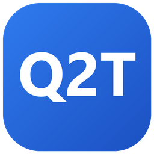
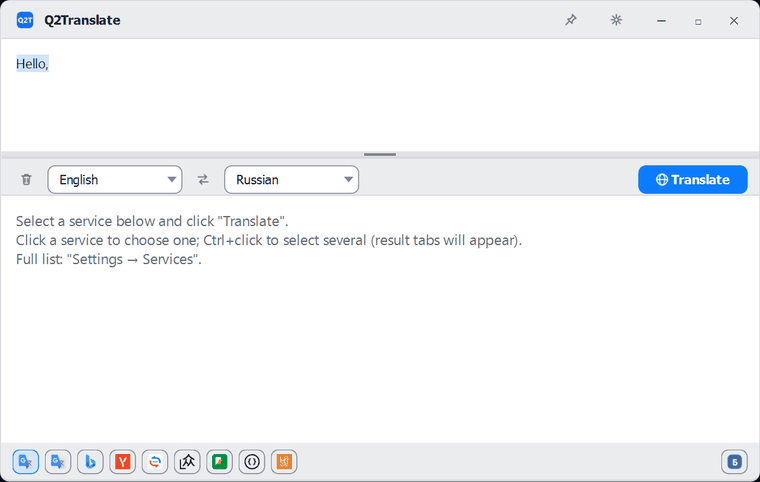
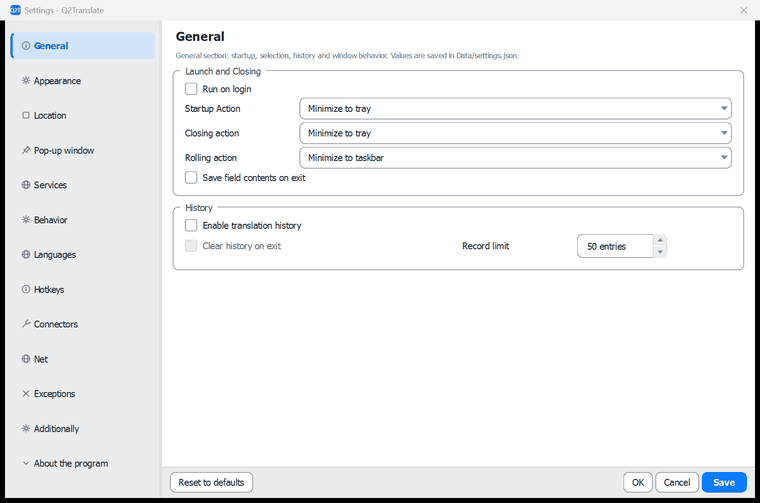
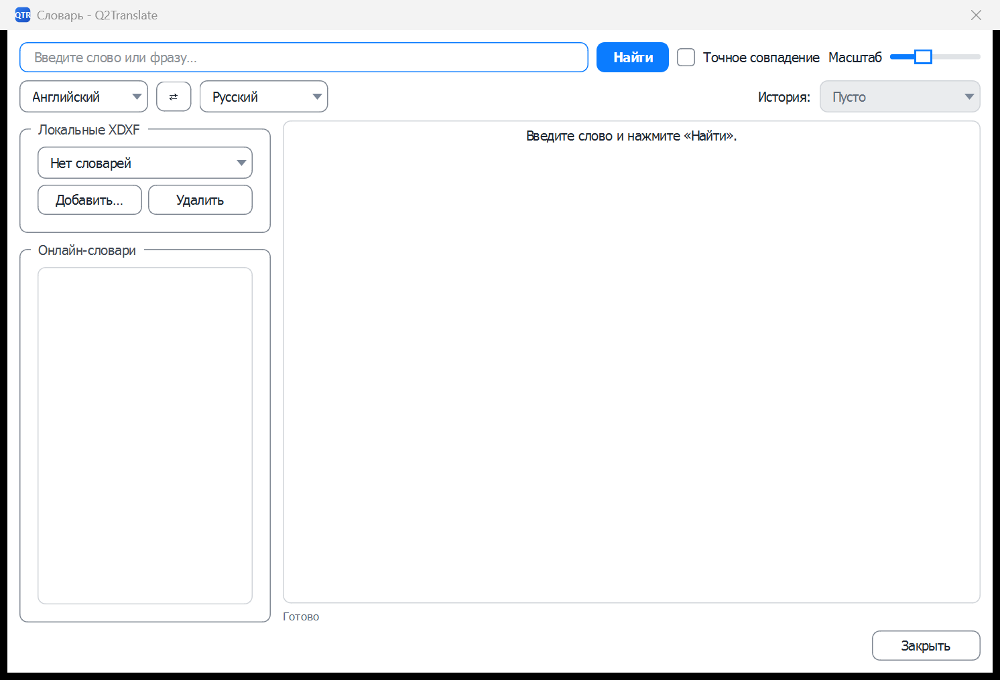
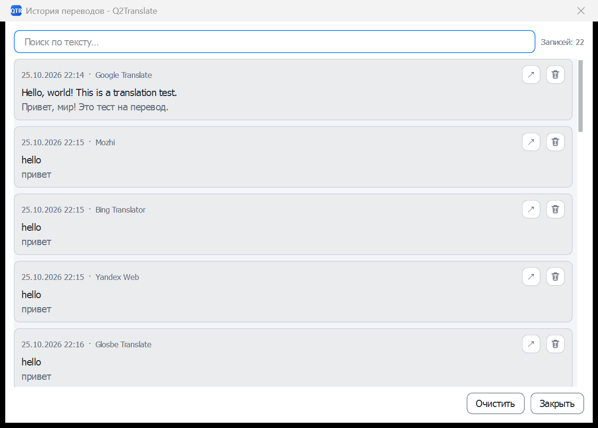
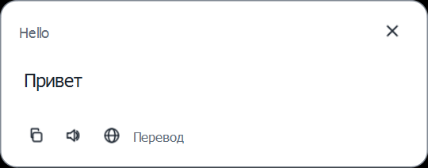
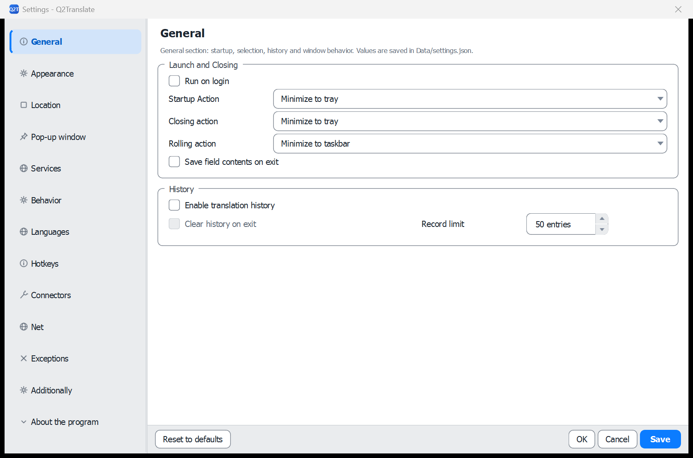
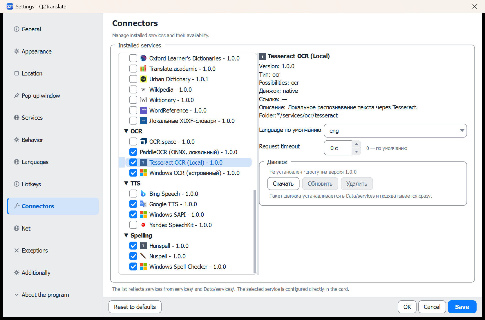

<p align="center">
  
</p>

### Q2Translate

Portable Windows translation workspace with 49 connectors, OCR, document translation, and offline dictionaries.

**Documentation:** [Architecture](docs/ARCHITECTURE.md) · [Interface](docs/INTERFACE.md) · [Connectors](docs/CONNECTORS.md) · [Image translation quality](docs/IMAGE_TRANSLATION_QUALITY.md) · [Русская версия](README_rus.md)

<p align="center">
  
</p>

<p align="center">
  
</p>

**English** · [Русская версия](README_rus.md)

> Before changing the connector runtime, settings defaults, or theme tokens, read [Architecture](docs/ARCHITECTURE.md) and the [Connector guide](docs/CONNECTORS.md) — these parts are load-bearing for all 49 connectors.

## Contents

1. [Overview](#overview)
2. [Key Features](#key-features)
3. [Quick Start](#quick-start)
4. [Versions](#versions)
5. [Usage](#usage)
6. [Interface languages](#interface-languages)
7. [Tools](#tools)
8. [Documentation & CLI](#documentation--cli)
9. [Contributing](#contributing)
10. [Third-party services](#third-party-services)
11. [License](#license)
12. [Acknowledgments](#acknowledgments)

## Overview

**Q2Translate** is a portable Windows translation client for people who translate selected text, documents, screenshots, and short phrases many times a day. It removes the browser round-trip: one hotkey, one window, 49 optional connectors, and local OCR and spelling when you need to stay offline.

## Key Features

- **Translation**: 17 online services, parallel requests to several connectors with one result tab per service, back translation, instant translation while typing, and mouse mode — hold `Ctrl` and select text with the mouse in any application.
- **Dictionaries**: 11 online dictionaries plus local XDXF files with exact-match search.
- **OCR**: capture a screen region (`Win+Shift+Q`), paste or drop images, and translate whole pages of images in place. Engines: Windows OCR, local Tesseract and PaddleOCR (ONNX) in the full build, or a vision LLM - one per file type (screen, images, PDF, DJVU).
- **Spelling**: Hunspell, Nuspell, or Windows Spell Checking with downloadable dictionaries and correction suggestions.
- **Speech**: text-to-speech for the source and the translation, voice input in the source editor through Windows speech recognition.
- **Documents**: layout-preserving translation of DOCX, PPTX, PDF (text layer and scans), DJVU, EPUB, FB2, XLIFF, subtitles, and 15+ other formats, plus a batch window for whole folders.
- **LLM**: 10 ready connectors for OpenAI, Claude, Gemini, DeepSeek, Qwen, Ollama, and more — translation, summarization, paraphrasing, dictionary articles, and OCR from an image; prompts are plain editable JSON (`prompts.json`).
- **Follow-up actions**: back translation, summarization, or paraphrasing right after a translation, plus automatic output — speak, copy, or show in a popup.
- **Interface**: 19 themes with a day/night schedule, 17 interface languages, quick popup, global hotkeys, tray, history with favorites, and proxy support.

### OCR by file type

The engine is chosen per file group in **Settings → OCR** ("OCR for screenshots", "OCR for images", "OCR for PDF", "OCR for DJVU"); an empty value falls back to the general OCR connector. Available engines: Windows OCR, Tesseract, PaddleOCR (ONNX), and vision-capable LLM connectors.

| Group | Trigger | Pipeline | Result |
|---|---|---|---|
| Screen region | `Win+Shift+Q` | no deskew (captures are upright), one text block | text into the editor |
| Images (png/jpg/jpeg/bmp/webp/tif/tiff) | paste from clipboard, batch | skew measurement and straightening, bubble grown from the recognized lines, one block per bubble, mask-aware typesetting of the translation, dictionary-based OCR fixup | translated image + text |
| PDF (text layer) | document translation | PDFium text extraction with a quality gate | translated PDF in the original layout |
| PDF (scan) / DJVU | document translation | `ddjvu`/PDFium page renders, per-page straightening and recognition | translated PDF |
| DJVU (text layer) | document translation | `djvutxt` extraction with a quality gate | translated `.txt` |

For screenshot OCR the language list has **Auto**: when several OCR languages are configured, Tesseract reads the capture with each candidate and keeps the result with the highest confidence.

The OCR stage itself: measure page skew on a downscaled copy and straighten the image (from ~3° of tilt the engine merges lines across bubbles, past 5° it reads nothing), then the default page segmentation keeps column order and table rows, and a wide-gap split keeps neighbouring speech bubbles apart. If a pass returns nothing readable, it retries once with single-block segmentation. PaddleOCR reads the whole page in one pass — its detector finds the lines itself.

The overlay stage typesets instead of stretching: the balloon mask is grown from the recognized text, its per-row width profile constrains every line, and the largest font that admits a balanced line break is chosen (`Image.TextFont`, `Image.MinFontPx`, `Image.MaxLines`, `Image.LineSpacing`, `Image.EraseMode`, `Image.TextOutline`, `Image.MinOcrConfidence`, `Image.LlmContext`, `Image.LengthBudget`, `Image.SplitParagraphs`). Lines are centred inside their own row span, so glyphs never cross the balloon outline and the text stays as large as the bubble allows. With an LLM connector selected for images, the translation also gets the neighbouring lines as scene context and a length budget; classic machine-translation services receive neither.

## Quick Start

### Requirements

- Windows 10/11 x64
- Git for Windows (the install block uses Git Bash)
- PowerShell 7+ (Windows PowerShell 5.1 works with slower single-connection downloads)
- About 3 GB of free disk space and internet access for the first build
- No Python runtime or installer is required

The application is a native desktop program, so there is no `.env` file. Shipped defaults live in `settings-default.json`; user settings live in `Data/settings.json`.

### Installation

Run these commands in Git Bash and replace `your-org` with the repository owner.

```bash
git clone https://github.com/your-org/Q2Translate.git
cd Q2Translate

# 1. Download and unpack Qt 6.8.3, MinGW 13.1, CMake, and Ninja
pwsh -ExecutionPolicy Bypass -File ./tools/download_toolchain.ps1

# 2. Build
export PATH="$PWD/.toolchain/qt/bin:$PWD/.toolchain/mingw/Tools/mingw1310_64/bin:$PWD/.toolchain/ninja:$PATH"
./.toolchain/cmake/bin/cmake.exe -S . -B work -G Ninja \
  -DCMAKE_BUILD_TYPE=Release \
  -DCMAKE_PREFIX_PATH="$PWD/.toolchain/qt"
./.toolchain/cmake/bin/cmake.exe --build work

# 3. Run
./work/"Q2Translate.exe"
```

Use MinGW, not MSVC: the bundled Nuspell/ICU import libraries in `third_party/` and the configured Qt build are MinGW-based. If Qt 6.8.3 MinGW is already installed, skip the bootstrap and point `CMAKE_PREFIX_PATH` at it.

## Usage

### Desktop interface

| Main window | Dictionary |
|---|---|
|  |  |

| History | Quick translation popup |
|---|---|
|  |  |

| Settings | Connectors |
|---|---|
|  |  |

Select one or more connector chips at the bottom of the main window, enter or select text, and press **Translate**. Multiple selected connectors open separate result tabs. Use the tray menu, global hotkeys, or the quick-translation popup for the same workflow without opening the main window.

Full UI reference: [Interface documentation](docs/INTERFACE.md).

### Hotkeys

| Action | Default |
|---|---|
| Quick translation of the selection or clipboard | `Ctrl+Q` |
| OCR screen capture | `Win+Shift+Q` |
| Show the main window | Double `Ctrl` |
| Listen, replace selection, dictionary, history, document, clipboard translation, focus fields | Unassigned — set in **Settings → Hotkeys** |

The hotkey editor ships two presets: **classic** (`Ctrl+E` listen, `Ctrl+D` dictionary, `Ctrl+I` OCR, `Ctrl+Shift+T` replace selection) and **modern** (`Ctrl+Shift+L`, `Ctrl+Shift+D`, `Ctrl+Shift+O`, `Ctrl+Shift+R`).

### Exceptions

**Settings → Exceptions** keeps a list of applications and window classes where hotkeys and mouse mode stay inactive (games, terminals, remote clients). An entry matches a process name plus an optional window class; the list is stored in `Data/Exceptions.json`.

### Headless diagnostics

```bash
# Check the application, plugins, translation, OCR, and dictionary pipeline
./work/"Q2Translate.exe" --selftest

# Probe selected connectors (the filter matches connector ids)
./work/"Q2Translate.exe" --probe-connectors google_translate,hunspell
```

### Portable package

```bash
./tools/deploy_portable.ps1 -Configuration Release
```

Two archives are written for every version: `build/Q2TranslatePortable_full_v<version>.zip` (all engines embedded) and `build/Q2TranslatePortable_small_v<version>.zip` (without Tesseract, PaddleOCR and Nuspell engines/models). See [Versions](#versions) for the difference. Every package build raises the patch number in `CMakeLists.txt` automatically; pass `-NoBump` to keep it or `-Version x.y.z` to set it explicitly.

### Updates

An update is the same archive unpacked over the old folder: the executable and `services/` are replaced, while `Data/` — settings, history, API keys, downloaded dictionaries — stays intact. In portable mode everything lives next to the executable (`portable.txt`); in installed mode user data stays in `%APPDATA%/Q2Translate/Data` independently of the version. Settings are migrated on start: new keys from `settings-default.json` are added without touching user values.

## Versions

Every release is built as two portable archives from the same sources and with the same version:

| Build | Archive | Size (2.7.57) | What is inside |
|---|---|---:|---|
| **Full** | `Q2TranslatePortable_full_v<version>.zip` | ~172 MB | Tesseract, PaddleOCR (ONNX Runtime + PP-OCRv5 models) and the Nuspell connector are bundled. All OCR engines and all spelling backends work offline. |
| **Small** | `Q2TranslatePortable_small_v<version>.zip` | ~47 MB | The Tesseract, PaddleOCR and Nuspell connector directories, engines and models are removed. OCR defaults to the built-in Windows OCR; spell checking defaults to Hunspell. |

Notes:

- Both archives contain the same application, connectors, interface translations and document pipeline; only the OCR/spelling engines differ.
- The small build keeps `libnuspell.dll` and the ICU DLLs because the executable imports them at startup. Removing them requires a separate build without Nuspell linkage.
- The small build does not include the Tesseract, PaddleOCR or Nuspell connectors; installing engine packages from a network source is not wired yet. Use the full build when local OCR for scans and PDF/DJVU, or Nuspell, is required.
- Installed engine packages live in `Data/services` and take precedence over bundled ones. The connector card shows **Download / Update / Delete** and the download button is disabled once the engine is installed.

## Interface languages

The UI ships in **17 languages**: Arabic, Bengali, Chinese (Simplified and Traditional), English, French, German, Hungarian, Indonesian, Italian, Japanese, Korean, Portuguese (Brazil), Russian, Spanish, Turkish, and Vietnamese. The language is selected in **Settings → Appearance** and applied on save.

Adding a language does not require a rebuild:

1. Copy any file from `data/Locales/` (for example `English.json`) to `<Language>.json` and translate the values — keep the keys as they are.
2. Put the file into `Locales/` next to the executable, or add it to `data/Locales/` and rebuild — the build copies it automatically.
3. Reopen **Settings → Appearance**: the new language appears in the list. Missing strings fall back to English, so a partial translation cannot break the interface.

Details: [Architecture → Localization](docs/ARCHITECTURE.md).

## Tools

Helper scripts live in `tools/`; each runs from the project root in PowerShell:

| Script | What it does |
|---|---|
| `download_toolchain.ps1` | Downloads and unpacks Qt 6.8.3, MinGW 13.1, CMake 3.30.5, and Ninja 1.12.1 into `.toolchain/`. Parameters: `-BaseUrl`, `-Connections`, `-ChunkBytes`, `-Force`. |
| `deploy_portable.ps1` | Release build, `windeployqt`, data, and third-party DLLs packaged into `build/Q2TranslatePortable_full_v<Version>.zip` and `..._small_v<Version>.zip`. Parameters: `-Configuration`, `-Version`, `-SkipBuild`. |
| `audit_contrast.ps1` | WCAG contrast audit of the built-in themes: text ≥ 4.5:1, borders and scrollbar ≥ 3:1, popup faded text; writes `contrast_report.txt`. |
| `audit_soft.ps1` | Computes softer color variants that still meet the contrast targets; writes `tools/audit_soft.txt`. |
| `audit_proposals.ps1` | Per-theme color fix proposals (accent text, `onAccent`, …); writes `tools/audit_proposals.txt`. |

## Documentation & CLI

There is no public REST or GraphQL API. Translation, dictionary, OCR, spelling, TTS, and LLM providers are sandboxed JavaScript or native connectors; the JavaScript entry point is `execute(capability, params)`.

| Method | Command / endpoint | Description | Access |
|---|---|---|---|
| CLI | `--selftest` | Runs the built-in plugin, translation, OCR, and dictionary checks | Local |
| CLI | `--probe-connectors <filter>` | Probes selected connectors and writes `Data/connector_probe.log` | Local / network for online connectors |
| CLI | `--translate-document <path>` | Translates one document with the active languages and writes a copy next to it | Local / network |
| CLI | `--translate-image <path> [lang] [source]` | Runs OCR, block translation and overlay for one image; writes `<name>.<lang>.png` next to the source, log in `Data/image-test.log` | Local / network |
| CLI | `--show-batch` | Opens the batch document translation window | Local |
| CLI | `--translate <text>` | Shows the main window and translates the given text | Local / network |
| CLI | `--set-source <text>` | Shows the main window with the text loaded into the source editor | Local |
| CLI | `--popup-text <text>` | Opens the quick-translation popup with the supplied text | Local |
| CLI | `--plugin-settings <id>` | Opens the settings dialog of one connector | Local |
| CLI | `--ocr-languages` | Opens the Tesseract language download manager | Local / network |
| CLI | `--tts-test [id] [text]` | Speaks a test phrase through a TTS connector and writes `Data/tts_probe.log` | Local / network |
| CLI | `--http-test [url]` | Checks connectivity through the configured proxy and writes `Data/http_probe.log` | Network |
| CLI | `--show-options` / `--show-dictionary` / `--show-history` / `--show-popup` / `--start-ocr` | Open the corresponding window at startup | Local |
| CLI | `--selection-test` | Translates the current selection inside the main window (automation helper) | Local / network |
| JS | `execute(capability, params)` | Connector entry point for translation, dictionary, OCR, TTS, and LLM capabilities | Sandboxed connector runtime |

### Documentation

- **[Architecture](docs/ARCHITECTURE.md)** — module map, connector runtime, threading model, data layout, packaging, CI, security.
- **[Interface](docs/INTERFACE.md)** — every window, settings page, popup, hotkeys, OCR, and document translation.
- **[Connectors](docs/CONNECTORS.md)** — manifest schema, JavaScript sandbox API, native providers, worked example.
- **[Image translation quality](docs/IMAGE_TRANSLATION_QUALITY.md)** — pipeline, typesetting, diagnostics and quality metrics.
- Russian versions: [Архитектура](docs/ARCHITECTURE.ru.md) · [Интерфейс](docs/INTERFACE.ru.md) · [Коннекторы](docs/CONNECTORS.ru.md).

## Contributing

Contributions are welcome:

- **Bug reports** — open an issue with reproduction steps; attach relevant lines from `Data/selftest.log`, `Data/connector_probe.log`, or `Data/Logs` and list the active connectors. Do not include API keys.
- **Feature requests** — describe the use case; check the [Connector guide](docs/CONNECTORS.md) first — many ideas fit as a connector without touching the core.
- **Pull requests** — keep `src/` warning-free (`-Wall -Wextra`), keep each manifest's `enabled_by_default` in sync with `DisabledServices` in `settings-default.json`, and read [Architecture](docs/ARCHITECTURE.md) before changing the connector runtime, the settings schema, or theme tokens.

## Third-party services

Q2Translate is only a client: the MIT license covers this repository, while every translation, dictionary, speech and LLM request is governed by the terms of the selected provider.

| Access type | Examples | What it means |
|---|---|---|
| **Official API** | DeepL, OCR.space, OpenAI, Claude, Gemini, Qwen, Groq | Uses the provider's documented API and your own key; follow its terms, quotas and content rules. |
| **Public API** | MyMemory, LibreTranslate, Wikipedia, Wiktionary | Public endpoint with quotas; attribution and usage limits may apply. |
| **Web endpoint (unofficial)** | Google Translate/Bing/Yandex web connectors, Sogou, Reverso, Youdao, most dictionaries and TTS | Emulates the public web interface. Such automated access may violate the provider's terms, can be blocked at any time, and has no SLA. |
| **Local** | Tesseract, PaddleOCR, Windows OCR, Hunspell, Nuspell, Local XDXF, Ollama, LM Studio | Runs on your machine or your own server; third-party service terms do not apply. |

The repository contains **no API keys, cookies or session tokens**. Keys are entered by the user and stored locally in `Data/settings.json`. The user is responsible for the content sent to third-party services, for compliance with their terms, and for any personal-data or confidentiality requirements.

## License

The project is released under the **MIT License** — see [LICENSE](./LICENSE). Third-party components keep their own licenses; the complete inventory — Qt (LGPL-3.0), Nuspell (LGPL-3.0), ICU, PDFium, yaml-cpp (MIT), Tesseract (Apache-2.0), MinGW runtime, and bundled data — is in [THIRD_PARTY_NOTICES](THIRD_PARTY_NOTICES.md). Connector icons are the trademarks of their respective services and are not covered by the MIT license — see `data/services/ICONS.md`.

## Acknowledgments

| Component | Used for | License |
|---|---|---|
| [Qt 6](https://www.qt.io/) | Widgets UI, networking, JavaScript engine | GPL-3.0 / LGPL-3.0 / commercial |
| [Nuspell](https://github.com/nuspell/nuspell) 5.1.9 | Spell checking with compounds and suggestions | LGPL-3.0 |
| [ICU](https://icu.unicode.org/) 76 | Unicode runtime for Nuspell | ICU license |
| [PDFium](https://pdfium.googlesource.com/pdfium/) | PDF text extraction and rendering | BSD-3-Clause |
| [yaml-cpp](https://github.com/jbeder/yaml-cpp) | YAML document parsing | MIT |
| [Tesseract](https://github.com/tesseract-ocr/tesseract) 5 + Leptonica | Local OCR, bundled in the `tesseract_local` connector | Apache-2.0 |
| Hunspell `.aff`/`.dic` format | Spelling dictionaries: English and Russian bundled, others downloadable | per dictionary |
| XDXF | Local dictionary format; dictionaries are downloaded separately | per dictionary |

