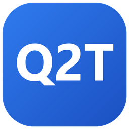
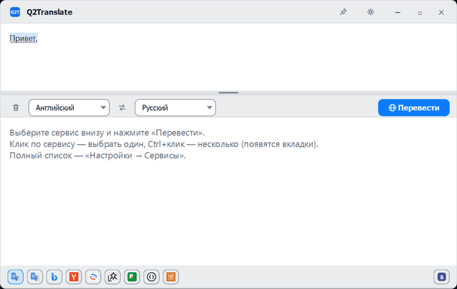
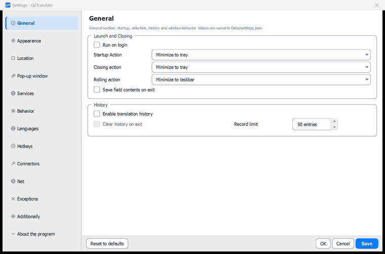
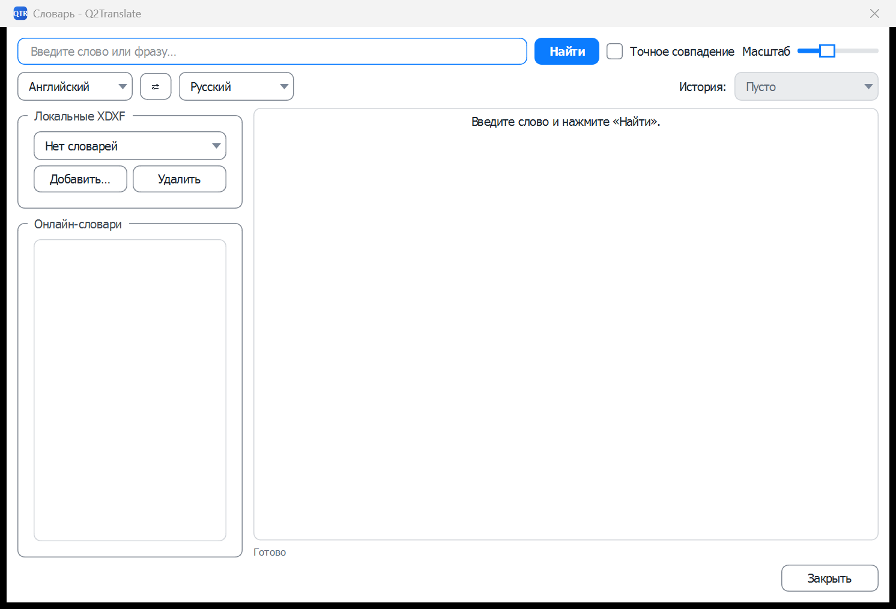
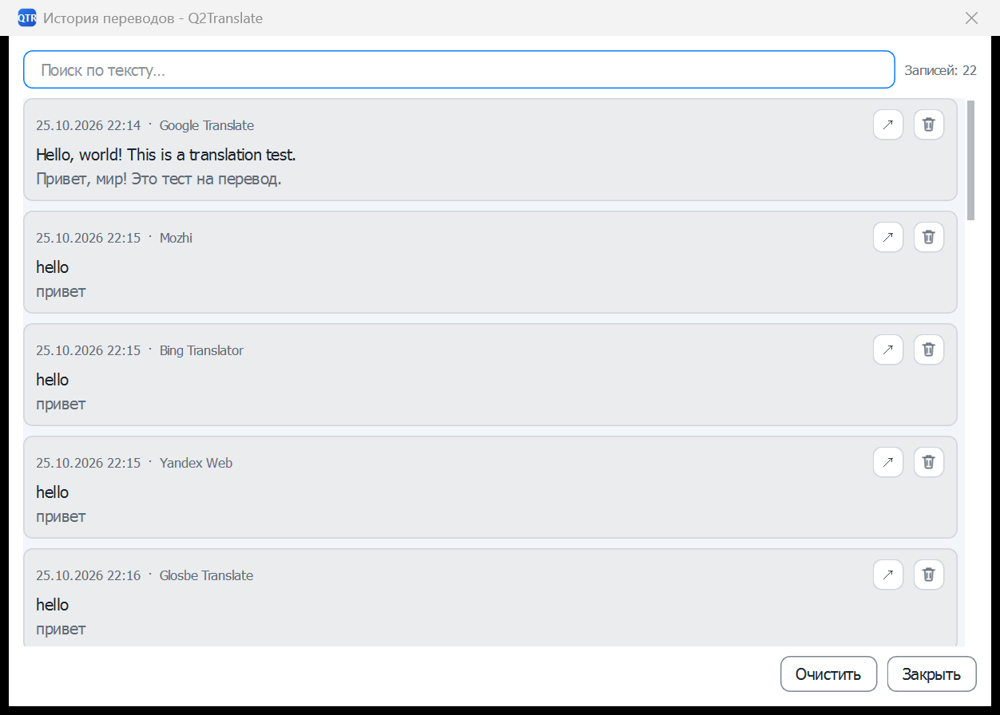
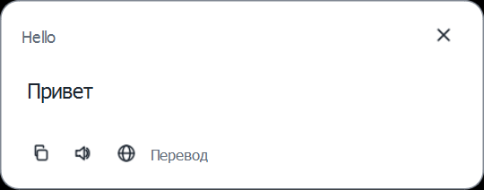
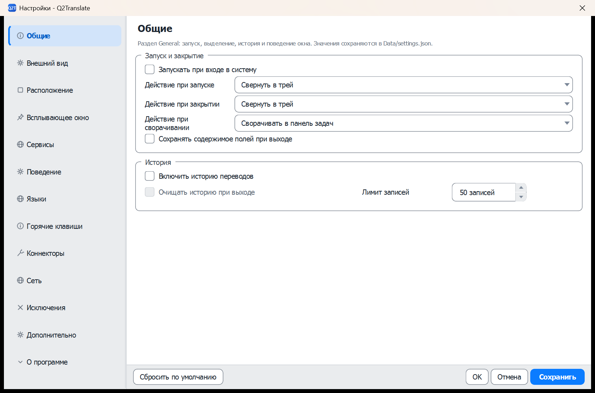
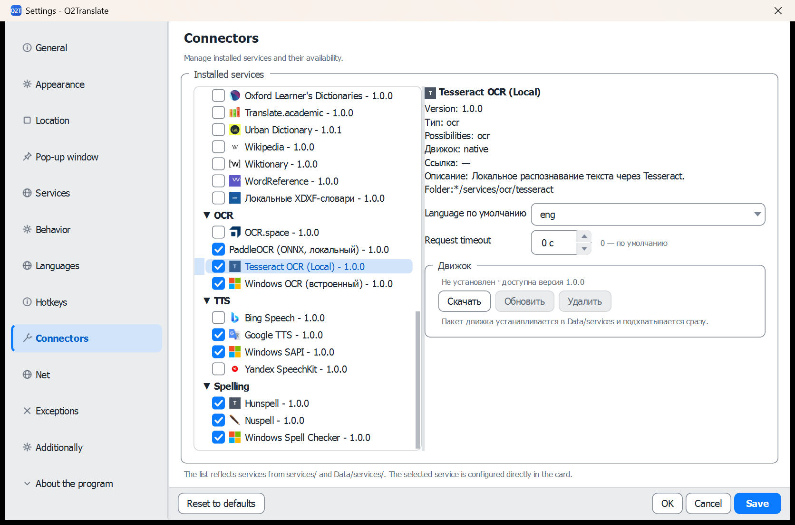

<p align="center">
  
</p>

### Q2Translate

Портативный переводчик для Windows: 49 коннекторов, OCR, перевод документов и офлайн-словари.

**Документация:** [Архитектура](docs/ARCHITECTURE.ru.md) · [Интерфейс](docs/INTERFACE.ru.md) · [Коннекторы](docs/CONNECTORS.ru.md) · [Качество перевода изображений](docs/IMAGE_TRANSLATION_QUALITY.ru.md) · [English version](README.md)

<p align="center">
  
</p>

<p align="center">
  
</p>

[English version](README.md) · **Русский**

> Перед изменением рантайма коннекторов, настроек по умолчанию или токенов тем прочитайте [Архитектуру](docs/ARCHITECTURE.ru.md) и [Руководство по коннекторам](docs/CONNECTORS.ru.md) — эти части нагружены всеми 49 коннекторами.

## Содержание

1. [Обзор](#обзор)
2. [Ключевые возможности](#ключевые-возможности)
3. [Быстрый старт](#быстрый-старт)
4. [Версии](#версии)
5. [Использование](#использование)
6. [Языки интерфейса](#языки-интерфейса)
7. [Инструменты](#инструменты)
8. [Документация и CLI](#документация-и-cli)
9. [Участие](#участие)
10. [Сторонние сервисы](#сторонние-сервисы)
11. [Лицензия](#лицензия)
12. [Благодарности](#благодарности)

## Обзор

**Q2Translate** — портативный переводчик для Windows для тех, кто много раз в день переводит выделенный текст, документы, скриншоты и короткие фразы. Он убирает поход в браузер: одна горячая клавиша, одно окно, 49 подключаемых коннекторов, локальный OCR и проверка орфографии без постоянного выхода в сеть.

## Ключевые возможности

- **Перевод**: 17 онлайн-сервисов, параллельные запросы к нескольким коннекторам с результатом в отдельной вкладке для каждого, обратный перевод, мгновенный перевод по мере ввода и mouse mode — зажатый `Ctrl` + выделение мышью в любом приложении.
- **Словари**: 11 онлайн-словарей и локальные XDXF-файлы с поиском по точному совпадению.
- **OCR**: захват области экрана (`Win+Shift+Q`), вставка и перетаскивание изображений, перевод страниц изображений прямо на картинке. Движки: Windows OCR, локальные Tesseract и PaddleOCR (ONNX) в полной сборке или vision-LLM — свой для каждого типа файла (скриншоты, изображения, PDF, DJVU).
- **Орфография**: Hunspell, Nuspell или Windows Spell Checking со скачиваемыми словарями и вариантами исправлений. Словарь выбирается по автоматически определённому языку исходного текста: кириллица — русский, латиница — английский.
- **Речь**: озвучивание исходного текста и перевода, голосовой ввод в редакторе исходника через распознавание речи Windows.
- **Документы**: перевод с сохранением структуры DOCX, PPTX, PDF, EPUB, FB2, XLIFF, субтитров и ещё 15+ форматов.
- **LLM**: 10 готовых коннекторов для OpenAI, Claude, Gemini, DeepSeek, Qwen, Ollama и других — перевод, суммаризация, перефразирование, словарные статьи и OCR по изображению; промпты — обычный редактируемый JSON (`prompts.json`).
- **Действия после перевода**: обратный перевод, суммаризация или перефразирование сразу после перевода, а также автоматический вывод — озвучить, скопировать или показать во всплывающем окне.
- **Интерфейс**: 19 тем с расписанием день/ночь, 17 языков интерфейса, всплывающее окно, глобальные горячие клавиши, трей, история с избранным, поддержка прокси.

### OCR по типам файлов

Движок выбирается по типу файла в **Настройки → OCR** («OCR для скриншотов», «OCR для изображений», «OCR для PDF», «OCR для DJVU»); пустое значение означает общий OCR-коннектор. Доступны: Windows OCR, Tesseract, PaddleOCR (ONNX) и LLM-коннекторы с распознаванием по изображению.

| Группа | Как запускается | Конвейер | Результат |
|---|---|---|---|
| Область экрана | `Win+Shift+Q` | без выравнивания (снимки всегда ровные), один текстовый блок | текст в редактор |
| Изображения (png/jpg/jpeg/bmp/webp/tif/tiff) | вставка из буфера, пакетная обработка | измерение перекоса и выравнивание, пузырь выращивается от распознанных строк, блок на реплику, вёрстка перевода по профилю пузыря, словарная правка OCR | переведённая картинка + текст |
| PDF с текстовым слоем | перевод документа | извлечение текста PDFium с проверкой качества | переведённый PDF в исходной вёрстке |
| Скан PDF / DJVU | перевод документа | рендер страниц, выравнивание и распознавание постранично | переведённый PDF |
| DJVU с текстовым слоем | перевод документа | извлечение `djvutxt` с проверкой качества | переведённый `.txt` |

OCR со скриншота сохраняет структуру строк (списки остаются списками); кнопка-метла в главном окне склеивает уже вставленный текст, а настройка в «Поведении» может очищать текст, вставляемый из буфера или OCR. В списке языков есть **«Авто»**: если настроено несколько языков OCR, Tesseract распознаёт кадр каждым кандидатом и оставляет результат с наибольшей уверенностью.

Сам OCR: перекос измеряется по уменьшенной копии и выравнивается (от ~3° движок склеивает строки соседних пузырей, после 5° не читает ничего), затем штатная сегментация сохраняет порядок колонок и строки таблиц, а разрыв по широким промежуткам не даёт соседним пузырям склеиться. Если проход вернул нечитаемый текст, один раз повторяется сегментацией единым блоком. PaddleOCR читает страницу целиком — детектор строк у него свой.

Наложение перевода — вёрстка, а не растягивание: маска пузыря выращивается от распознанного текста, профиль ширины по строкам маски ограничивает каждую строку, а размер шрифта выбирается максимальный, при котором существует сбалансированный перенос (`Image.TextFont`, `Image.MinFontPx`, `Image.MaxLines`, `Image.LineSpacing`, `Image.EraseMode`, `Image.TextOutline`, `Image.MinOcrConfidence`, `Image.LlmContext`, `Image.LengthBudget`, `Image.SplitParagraphs`). Строки центрируются в своём интервале, поэтому буквы не пересекают контур пузыря, а текст остаётся настолько крупным, насколько позволяет пузырь. С коннектором LLM для изображений дополнительно работают контекст соседних реплик и бюджет длины перевода; для обычных сервисов перевода эти параметры не передаются.

## Быстрый старт

### Требования

- Windows 10/11 x64
- Git for Windows (блок установки использует Git Bash)
- PowerShell 7+ (Windows PowerShell 5.1 работает, но скачивает одним соединением медленнее)
- Около 3 ГБ свободного места и интернет при первой сборке
- Python и установщик не требуются

Приложение нативное, поэтому файл `.env` не используется. Заводские настройки лежат в `settings-default.json`, пользовательские — в `Data/settings.json`.

### Установка

Выполните команды в Git Bash и замените `your-org` на владельца репозитория.

```bash
git clone https://github.com/your-org/Q2Translate.git
cd Q2Translate

# 1. Скачать и распаковать Qt 6.8.3, MinGW 13.1, CMake и Ninja
pwsh -ExecutionPolicy Bypass -File ./tools/download_toolchain.ps1

# 2. Собрать
export PATH="$PWD/.toolchain/qt/bin:$PWD/.toolchain/mingw/Tools/mingw1310_64/bin:$PWD/.toolchain/ninja:$PATH"
./.toolchain/cmake/bin/cmake.exe -S . -B work -G Ninja \
  -DCMAKE_BUILD_TYPE=Release \
  -DCMAKE_PREFIX_PATH="$PWD/.toolchain/qt"
./.toolchain/cmake/bin/cmake.exe --build work

# 3. Запустить
./work/"Q2Translate.exe"
```

Используйте MinGW, а не MSVC: импорт-библиотеки Nuspell/ICU в `third_party/` и сборка Qt рассчитаны на MinGW. Если Qt 6.8.3 MinGW уже установлен, подготовку можно пропустить и указать `CMAKE_PREFIX_PATH` на него.

## Использование

### Интерфейс

| Главное окно | Словарь |
|---|---|
|  |  |

| История | Всплывающее окно |
|---|---|
|  |  |

| Настройки | Коннекторы |
|---|---|
|  |  |

Выберите один или несколько коннекторов внизу главного окна, введите или выделите текст и нажмите **Перевести**. При нескольких коннекторах результаты открываются во вкладках. Тот же сценарий доступен из меню в трее, глобальных горячих клавиш и всплывающего окна.

Полное описание интерфейса: [Документация по интерфейсу](docs/INTERFACE.ru.md).

### Горячие клавиши

| Действие | По умолчанию |
|---|---|
| Быстрый перевод выделения или буфера | `Ctrl+Q` |
| OCR — захват области экрана | `Win+Shift+Q` |
| Показать главное окно | Двойной `Ctrl` |
| Озвучивание, замена выделенного, словарь, история, документ, перевод буфера, фокус полей | Не назначено — задаётся в **Настройки → Горячие клавиши** |

Редактор клавиш содержит два профиля: **классический** (`Ctrl+E` озвучить, `Ctrl+D` словарь, `Ctrl+I` OCR, `Ctrl+Shift+T` заменить выделенное) и **современный** (`Ctrl+Shift+L`, `Ctrl+Shift+D`, `Ctrl+Shift+O`, `Ctrl+Shift+R`).

### Исключения

**Настройки → Исключения** — список приложений и классов окон, где горячие клавиши и mouse mode не срабатывают (игры, терминалы, удалённые клиенты). Запись содержит имя процесса и необязательный класс окна; список хранится в `Data/Exceptions.json`.

### Диагностика без GUI

```bash
# Проверить приложение, плагины, перевод, OCR и словари
./work/"Q2Translate.exe" --selftest

# Проверить выбранные коннекторы (фильтр по id)
./work/"Q2Translate.exe" --probe-connectors google_translate,hunspell
```

### Портативный архив

```bash
./tools/deploy_portable.ps1 -Configuration Release
```

Для каждой версии создаются два архива: `build/Q2TranslatePortable_full_v<версия>.zip` (все движки внутри) и `build/Q2TranslatePortable_small_v<версия>.zip` (без движков и моделей Tesseract, PaddleOCR и Nuspell). Разница описана в разделе [Версии](#версии).

### Обновление

Обновление — это тот же архив, распакованный поверх старой папки: исполняемый файл и `services/` заменяются, а `Data/` — настройки, история, API-ключи, скачанные словари — остаётся нетронутой. В портативном режиме всё лежит рядом с exe (`portable.txt`); в установленном режиме данные пользователя хранятся в `%APPDATA%/Q2Translate/Data` независимо от версии. Настройки мигрируют при запуске: новые ключи из `settings-default.json` добавляются, не трогая значения пользователя.

## Версии

Каждый релиз собирается в виде двух портативных архивов из одних и тех же исходников и с одной версией:

| Сборка | Архив | Размер (2.8.1) | Что внутри |
|---|---|---:|---|
| **Полная** | `Q2TranslatePortable_full_v<версия>.zip` | ~172 МБ | Встроены Tesseract, PaddleOCR (ONNX Runtime + модели PP-OCRv5) и коннектор Nuspell. Все OCR-движки и все спеллчекеры работают офлайн. |
| **Урезанная** | `Q2TranslatePortable_small_v<версия>.zip` | ~47 МБ | Удалены каталоги, движки и модели Tesseract, PaddleOCR и Nuspell. OCR по умолчанию — встроенный Windows OCR; проверка орфографии — Hunspell. |

Примечания:

- В обоих архивах одно и то же приложение, коннекторы, переводы интерфейса и конвейер документов; отличаются только OCR- и спелл-движки.
- В урезанной сборке остаются `libnuspell.dll` и DLL ICU: исполняемый файл импортирует их при старте. Полностью убрать их можно только отдельной сборкой без линковки Nuspell.
- В урезанной сборке нет коннекторов Tesseract, PaddleOCR и Nuspell; установка движков из сетевого источника пока не подключена. Если нужен локальный OCR сканов и PDF/DJVU или Nuspell — используйте полную сборку.
- Установленные пакеты движков лежат в `Data/services` и имеют приоритет над встроенными. В карточке коннектора есть кнопки **Скачать / Обновить / Удалить**, а после установки движка кнопка «Скачать» становится неактивной.

## Языки интерфейса

Интерфейс поставляется на **17 языках**: арабский, бенгальский, английский, испанский, итальянский, индонезийский, китайский (упрощённый и традиционный), корейский, немецкий, португальский (Бразилия), русский, турецкий, венгерский, вьетнамский, французский и японский. Язык выбирается в **Настройки → Внешний вид** и применяется при сохранении.

Добавление языка не требует пересборки:

1. Скопируйте любой файл из `data/Locales/` (например `English.json`) в `<Язык>.json` и переведите значения — ключи менять нельзя.
2. Положите файл в `Locales/` рядом с exe или добавьте в `data/Locales/` и пересоберите — сборка скопирует его автоматически.
3. Снова откройте **Настройки → Внешний вид**: новый язык появится в списке. Непереведённые строки остаются на английском, поэтому частичный перевод не ломает интерфейс.

Подробнее: [Архитектура → Локализация](docs/ARCHITECTURE.ru.md).

## Инструменты

Вспомогательные скрипты лежат в `tools/`; каждый запускается из корня проекта в PowerShell:

| Скрипт | Что делает |
|---|---|
| `download_toolchain.ps1` | Скачивает и распаковывает Qt 6.8.3, MinGW 13.1, CMake 3.30.5 и Ninja 1.12.1 в `.toolchain/`. Параметры: `-BaseUrl`, `-Connections`, `-ChunkBytes`, `-Force`. |
| `deploy_portable.ps1` | Release-сборка, `windeployqt`, данные и сторонние DLL упаковываются в `build/Q2TranslatePortable_full_v<Version>.zip` и `..._small_v<Version>.zip`. Параметры: `-Configuration`, `-Version`, `-SkipBuild`. |
| `audit_contrast.ps1` | WCAG-аудит контраста встроенных тем: текст ≥ 4.5:1, границы и скроллбар ≥ 3:1, приглушённый текст попапа; пишет `contrast_report.txt`. |
| `audit_soft.ps1` | Подбирает более мягкие варианты цветов, которые всё ещё проходят по контрасту; пишет `tools/audit_soft.txt`. |
| `audit_proposals.ps1` | Предложения по исправлению цветов для каждой темы (акцентный текст, `onAccent`, …); пишет `tools/audit_proposals.txt`. |

## Документация и CLI

Публичного REST или GraphQL API нет. Перевод, словари, OCR, орфография, TTS и LLM работают через изолированные JavaScript- или нативные коннекторы; точка входа JavaScript — `execute(capability, params)`.

| Метод | Команда / endpoint | Описание | Доступ |
|---|---|---|---|
| CLI | `--selftest` | Встроенная проверка плагинов, перевода, OCR и словарей | Локально |
| CLI | `--probe-connectors <filter>` | Проверка выбранных коннекторов с записью в `Data/connector_probe.log` | Локально / сеть для онлайн-коннекторов |
| CLI | `--translate-document <path>` | Перевод документа с активными языками и сохранением копии рядом с исходником | Локально / сеть |
| CLI | `--translate-image <path> [lang] [source]` | Распознаёт изображение, переводит блоки и рисует перевод на картинке; результат `<имя>.<язык>.png`, лог в `Data/image-test.log` | Локально / сеть |
| CLI | `--show-batch` | Открывает окно пакетного перевода документов | Локально |
| CLI | `--translate <text>` | Показывает главное окно и переводит переданный текст | Локально / сеть |
| CLI | `--set-source <text>` | Показывает главное окно с текстом в редакторе исходника | Локально |
| CLI | `--popup-text <text>` | Открыть всплывающее окно с переданным текстом | Локально |
| CLI | `--plugin-settings <id>` | Открывает окно настроек одного коннектора | Локально |
| CLI | `--ocr-languages` | Открывает менеджер загрузки языков Tesseract | Локально / сеть |
| CLI | `--tts-test [id] [text]` | Проверяет TTS-коннектор озвучиванием тестовой фразы, пишет `Data/tts_probe.log` | Локально / сеть |
| CLI | `--http-test [url]` | Проверяет доступность сети через настроенный прокси, пишет `Data/http_probe.log` | Сеть |
| CLI | `--show-options` / `--show-dictionary` / `--show-history` / `--show-popup` / `--start-ocr` | Открывают соответствующее окно при запуске | Локально |
| CLI | `--selection-test` | Переводит текущее выделение внутри главного окна (помощник автоматизации) | Локально / сеть |
| JS | `execute(capability, params)` | Точка входа коннектора для перевода, словарей, OCR, TTS и LLM | Песочница коннекторов |

### Документация

- **[Архитектура](docs/ARCHITECTURE.ru.md)** — карта модулей, рантайм коннекторов, модель потоков, данные, упаковка, CI, безопасность.
- **[Интерфейс](docs/INTERFACE.ru.md)** — все окна, страницы настроек, попап, горячие клавиши, OCR и перевод документов.
- **[Коннекторы](docs/CONNECTORS.ru.md)** — схема манифеста, API JavaScript-песочницы, нативные провайдеры, разобранный пример.
- **[Качество перевода изображений](docs/IMAGE_TRANSLATION_QUALITY.ru.md)** — конвейер, вёрстка, диагностика и метрики качества. [English version](docs/IMAGE_TRANSLATION_QUALITY.md).
- Английские версии: [Architecture](docs/ARCHITECTURE.md) · [Interface](docs/INTERFACE.md) · [Connectors](docs/CONNECTORS.md).

## Участие

Приветствуются любые вклады:

- **Баг-репорты** — открывайте issue с шагами воспроизведения; приложите относящиеся строки из `Data/selftest.log`, `Data/connector_probe.log` или `Data/Logs` и перечислите активные коннекторы. Не включайте API-ключи.
- **Предложения** — опишите сценарий использования; сначала загляните в [Руководство по коннекторам](docs/CONNECTORS.ru.md) — многие идеи реализуются коннектором без правок ядра.
- **Pull request'ы** — держите `src/` без предупреждений (`-Wall -Wextra`), согласуйте `enabled_by_default` каждого манифеста с `DisabledServices` из `settings-default.json` и прочитайте [Архитектуру](docs/ARCHITECTURE.ru.md) перед изменением рантайма коннекторов, схемы настроек или токенов тем.

## Сторонние сервисы

Q2Translate — только клиент. Лицензия MIT покрывает код репозитория, а каждый запрос перевода, словаря, озвучивания и LLM регулируется условиями выбранного сервиса.

| Тип доступа | Примеры | Что это значит |
|---|---|---|
| **Официальный API** | DeepL, OCR.space, OpenAI, Claude, Gemini, Qwen, Groq | Документированный API и ваш ключ; соблюдайте условия, лимиты и правила контента. |
| **Публичный API** | MyMemory, LibreTranslate, Wikipedia, Wiktionary | Публичный endpoint с квотами; возможны требования к атрибуции и ограничения использования. |
| **Веб-эндпоинт (неофициальный)** | веб-коннекторы Google Translate/Bing/Yandex, Sogou, Reverso, Youdao, большинство словарей и TTS | Имитирует веб-интерфейс. Такой автоматизированный доступ может нарушать условия сервиса, быть заблокирован в любой момент и не имеет SLA. |
| **Локальный** | Tesseract, PaddleOCR, Windows OCR, Hunspell, Nuspell, Local XDXF, Ollama, LM Studio | Работает на вашей машине или вашем сервере; условия сторонних сервисов не применяются. |

В репозитории **нет API-ключей, cookies и сессионных токенов**. Ключи вводит пользователь, они хранятся локально в `Data/settings.json`. Пользователь отвечает за передаваемый третьим сторонам контент, соблюдение их условий, а также требований к персональным данным и конфиденциальности.

## Лицензия

Проект распространяется по **лицензии MIT** — см. [LICENSE](./LICENSE). Сторонние компоненты сохраняют свои лицензии; полный перечень — Qt (LGPL-3.0), Nuspell (LGPL-3.0), ICU, PDFium, yaml-cpp (MIT), Tesseract (Apache-2.0), рантайм MinGW и встроенные данные — приведён в [THIRD_PARTY_NOTICES](THIRD_PARTY_NOTICES.md). Иконки коннекторов являются товарными знаками соответствующих сервисов и не входят в лицензию MIT — см. `data/services/ICONS.md`.

## Благодарности

| Компонент | Для чего | Лицензия |
|---|---|---|
| [Qt 6](https://www.qt.io/) | Интерфейс Widgets, сеть, JavaScript-движок | GPL-3.0 / LGPL-3.0 / commercial |
| [Nuspell](https://github.com/nuspell/nuspell) 5.1.9 | Проверка орфографии: составные слова, подсказки | LGPL-3.0 |
| [ICU](https://icu.unicode.org/) 76 | Unicode-рантайм для Nuspell | ICU license |
| [PDFium](https://pdfium.googlesource.com/pdfium/) | Извлечение текста и рендер PDF | BSD-3-Clause |
| [yaml-cpp](https://github.com/jbeder/yaml-cpp) | Разбор YAML-документов | MIT |
| [Tesseract](https://github.com/tesseract-ocr/tesseract) 5 + Leptonica | Локальный OCR, встроен в коннектор `tesseract_local` | Apache-2.0 |
| Формат Hunspell `.aff`/`.dic` | Словари орфографии: английский и русский в поставке, остальные скачиваются | зависит от словаря |
| XDXF | Формат локальных словарей; словари скачиваются отдельно | зависит от словаря |

