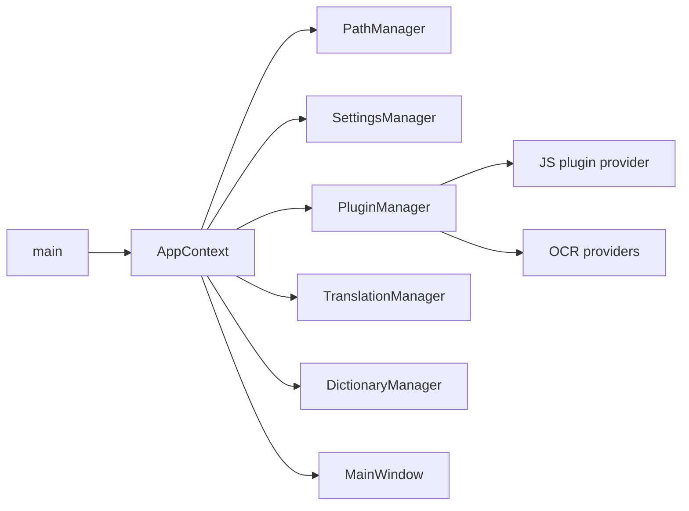

# Architecture

[README](../README.md) · [Interface](INTERFACE.md) · [Connectors](CONNECTORS.md) · [Русская версия](ARCHITECTURE.ru.md)

## Goals

Q2Translate is a portable Windows translation client. The architecture optimizes for:

- a self-contained ZIP distribution;
- a small, predictable UI runtime based on Qt Widgets;
- connectors that can be added or changed without rebuilding the application;
- preserving user data and source documents;
- clear separation between translation, document processing, dictionaries, and presentation.

The application uses **C++20**, **Qt 6.8.3 Widgets**, **MinGW 13.1**, **CMake 3.30.5**, and **Ninja 1.12.1**. The toolchain is prepared by `tools/download_toolchain.ps1` in `.toolchain/` and is not committed to Git.

## Module map

```text
src/
  main.cpp                  process entry point, command-line probes
  core/                     settings, paths, JSON storage, language routing, translation, history
  services/                 plugin manager, JS runtime, HTTP/JS bridges, OCR, TTS, and spelling providers
    spell_provider_base.*   shared Hunspell/Nuspell provider implementation
  modules/
    dictionary/             XDXF parser and dictionary manager
    document/               document readers and translation jobs
  platform/win/             clipboard, global hotkeys, speech, Win32 helpers
  ui/                       main window, popup, dictionary, history, settings
    theme_manager.*         theme loading and stylesheet token substitution
resources/                  style.qss, themes.json, icons, manifest
data/
  services/                 shipped connectors and OCR/spelling data
  Themes/                   General/ app themes, Popup/ popup styles
  Locales/                  interface translations (17 languages)
third_party/
  pdfium/                   PDF text extraction and rendering (BSD-3-Clause)
  yaml-cpp/                 YAML parser (MIT)
  nuspell/                  Nuspell 5.1.9 headers, DLL and LGPL license
  icu/                      ICU 76 Unicode runtime and headers for Nuspell
  qt/                       Qt license texts (LGPL-3.0, GPL-3.0) and notice
  tesseract/                Tesseract Apache-2.0 license text
  mingw-runtime/            GCC runtime library exception notice
```

CMake copies `settings-default.json` and the contents of `data/` next to the executable, so runtime code reads `services/`, `Themes/`, and `Locales/` from the application directory.

## Startup

1. `main.cpp` creates `QApplication`, applies the saved theme, and creates `AppContext`.
2. `PathManager` chooses portable mode (`portable.txt` next to the executable) or installed mode (`%APPDATA%/Q2Translate/Data`).
3. `SettingsManager` loads `Data/settings.json`, merging new defaults from `settings-default.json`.
4. `PluginManager` scans `services/` and `Data/services/`, parses manifests, and creates providers.
5. `LanguageRouter`, `TranslationManager`, `HistoryManager`, `DictionaryManager`, and `ExceptionsManager` are wired into `AppContext`.
6. `MainWindow` builds the UI, restores layout/content, and applies the active theme.



## Settings and data

- `SettingsManager` stores nested keys such as `General.MinimizeAction`, `General.LanguageDetection`, `Appearance.ThemeName`, and `Internet.Timeout`.
- Defaults are versioned in `settings-default.json`; missing keys are filled without overwriting user values.
- One-time migrations preserve old profiles (minimize/close actions, hotkey profile revision, removed preset keys).
- User connector settings are stored under `Data/services/<id>/`; shipped connector settings stay read-only.
- History is capped at 50 entries by default (`Application.HistoryLimit`).
- Exceptions and user dictionaries are persisted separately from settings.

## Data layout

Everything the application writes lives under the data root (`Data/` next to the executable in portable mode, `%APPDATA%/Q2Translate/Data` otherwise):

| Path | Contents |
|---|---|
| `settings.json` | User settings, merged over `settings-default.json`. |
| `services/<id>/settings.json` | Per-connector settings (API keys, endpoints, models). |
| `History.json` | Translation history (`History` array, capped by `Application.HistoryLimit`). |
| `DictionaryHistory.json` | Last 30 dictionary lookups. |
| `Exceptions.json` | Hotkey and mouse-mode exceptions. |
| `selftest.log` | Full `--selftest` output. |
| `connector_probe.log` | `--probe-connectors` results, one line per capability. |
| `tts_probe.log` / `http_probe.log` | `--tts-test` and `--http-test` results. |
| `Logs/` | Created at startup for diagnostic output. |

## Connector runtime

A connector is a directory with a `manifest.json`, optional `service.js`, icon, and any private resources.

```text
services/translate/google_translate/
  manifest.json
  service.js
  icon.png
```

Manifest fields include `id`, `name`, `type`, `engine`, `capabilities`, `settings_schema`, optional `link`, and `service_script`. `engine` is `javascript` or `native` (for example, the local XDXF dictionary). Native manifests select an implementation through `native_provider` or `native_executable`.

`PluginManager`:

1. scans shipped and user service roots;
2. parses manifests and resolves icon/script paths;
3. creates `JsPluginProvider` instances for JavaScript connectors and the appropriate native provider for `spelling`, `tts`, `ocr`, and `dictionary` connectors;
4. exposes enabled providers by capability (`translate`, `dictionary`, `ocr`, `spelling`, `tts`, `llm`);
5. keeps user connectors in `Data/services` overriding shipped ones by id;
6. uses `DisabledServices` as the default-state source of truth; each manifest's `enabled_by_default` agrees with it.

The complete manifest schema, the sandbox API reference (`http`, `qtranslate`, result contract), native provider values, and a worked example live in [Connectors](CONNECTORS.md).

## JavaScript bridge

`JsPluginProvider` creates a fresh `QJSEngine` per execution and installs:

- `http` → `HttpBridge` (`get`, `post`, `multipart_post`) with a process-wide cookie jar;
- `qtranslate` → `JsBridge` (`loadJSON`, `md5`, `aesDecryptBase64`, `cacheGet`, `cacheSet`);
- the connector script.

HTTP runs through `QNetworkAccessManager`; connectors never access the filesystem or network directly. AES decryption is implemented with Windows CNG (`bcrypt`). The in-memory cache is shared across executions of one connector and is used for short-lived auth tokens and keys. `loadJSON()` reads connector-local JSON files such as `prompts.json` and `manifest.json`; shared connector implementations use it to select their host and mode.

`HttpBridge` returns `{status, body, body_base64, content_type, error}` for every call. Timeouts (`Internet.Timeout`, `ConnectTimeout`, `DataTimeout`), retries (`RetryFailed`, `RetryCount`, `RetryDelay`), and the proxy (`Proxy.*`: system, manual with authentication, or none) come from the settings and apply to every connector uniformly.

## Threading model

- `JsPluginProvider::executeAsync()` runs the whole script on a `QtConcurrent` worker thread and delivers the result on the UI thread through a `QFutureWatcher`, so a slow connector never blocks the interface or the other connectors.
- The HTTP bridge is synchronous inside the script but driven by a local `QEventLoop` with the configured timeouts; TLS verification is never disabled.
- XDXF search runs on a `QtConcurrent` worker (`DictionaryManager::searchLocalAsync`).
- Probes run on the main thread in local event loops with hard timeouts: 12 s per connector in `--probe-connectors`, 45 s per stage in `--selftest`, 30 s in `--tts-test`.
- Voice input launches a hidden PowerShell process (`System.Speech`) and feeds the recognized text back into the source editor.

## Translation flow

1. `MainWindow::onTranslate()` collects text, source/target languages, and the checked service chips.
2. `TranslationManager` reads `General.LanguageDetection`:
   - `local` — detects `auto` through `LanguageRouter` before the request and uses that value for the UI and history;
   - `service` — sends `auto` to the connector and keeps the connector's `detected_lang` in the result.
3. `TranslationManager` builds a parameter object and calls each selected provider asynchronously; a slow connector does not block the others.
4. Results are emitted as `serviceResult`; the UI creates one result tab per service when several services are selected.
5. Successful translations are written to history unless disabled.
6. The popup uses the same manager with the active service list.

## Follow-up calls and LLM

- After a translation, `MainWindow` can issue a follow-up call (`General.AdditionalCall`): `back` (back translation through `translate`), `summ` (`summarize`), or `rewr` (`paraphrase`). The provider is `ServiceProviders.summ`/`rewr` or `General.AdditionalCallProvider`, falling back to the first capable connector.
- LLM connectors declare `translate`, `summarize`, `paraphrase`, `dictionary`, and `ocr_vision` capabilities. Prompts live in each connector's `prompts.json` with `{source}`, `{target}`, `{text}` placeholders loaded through `loadJSON()`.
- `General.AdditionalOutputType` triggers an automatic output after translation — speak, copy to clipboard, or show in a popup — using either the translation or the source text (`General.AdditionalOutputSource`).

## Global input

- Assigned hotkeys are registered with `RegisterHotKey`; defaults are `Ctrl+Q` (quick translation) and `Win+Shift+Q` (OCR).
- A low-level `WH_KEYBOARD_LL` hook detects the double-`Ctrl` gesture that raises the main window; `HotKeys.Preset` offers `classic` and `modern` key sets.
- A low-level `WH_MOUSE_LL` hook implements mouse mode (`Advanced.EnableMouseModeOnCtrl`): hold `Ctrl` and select text with the mouse to translate it.
- `ExceptionsManager` keeps applications and window classes where hotkeys and mouse mode stay inactive in `Data/Exceptions.json`; entries match a process name and an optional window class, case-insensitively, with separate disabled and enabled lists.

## Document translation

`DocumentTranslationJob` is the shared pipeline for every document format:

1. choose a parser by extension;
2. extract translatable segments and preserve a format-specific write-back callback;
3. translate segments sequentially through the first active service;
4. write a new file next to the source as `<name>.<target>.<extension>`.

| Family | Parser / writer | Preservation strategy |
|---|---|---|
| DOCX, PPTX | Qt XML + `QZipReader/QZipWriter` | QDom tree, text redistributed across original runs |
| PDF | PDFium + `QPdfWriter` | page render, original text masked with sampled background, translated text in original blocks |
| Scanned PDF | PDFium render + OCR + `QPdfWriter` | pages without a text layer are straightened, recognized page by page, and the straightened bitmap becomes the page background |
| DJVU | external `ddjvu.exe` + scanned-PDF path | the file is converted to a rasterized PDF first, then recognized like a scan |
| Image (PNG, JPEG, …) | OCR + `image_overlay` | blocks are translated as wholes and drawn back into their own boxes |
| FB2 | QDomDocument | text nodes inside paragraphs, subtitles, poem lines |
| EPUB | QZip + HTML tokenizer | XHTML text nodes; CSS/images untouched; `mimetype` first and stored |
| XLIFF/XLF, TS | QDomDocument | source/target units, inline elements cloned and text distributed |
| JSON | in-place tokenizer | string values only, keys/order/whitespace preserved |
| XML | in-place tokenizer | text nodes only; tags, attributes, CDATA, comments preserved |
| Properties, INI | line parser | values only; keys, sections, comments preserved |
| YAML/YML | yaml-cpp | scalar values; valid YAML re-emitted |
| SRT, VTT | cue parser | timings/indices preserved; cue text translated as a block |
| ASS/SSA | Events parser | only `Dialogue:` text; override tags and `\N` protected |
| CSV | RFC 4180 parser | fields, delimiter, quoting and multiline values preserved |
| TXT, Markdown, HTML | text/token parser | line endings, Markdown fences, HTML tags/script/style preserved |

The source file is opened read-only. Output is written to a temporary file and moved into place only after successful parsing and translation.

## Themes

`ThemeManager` reads the built-in `:/themes.json` resource as the base palette and merges `Themes/General/*.json` next to the executable. Popup styles are loaded from `Themes/Popup/*.json`. Files are keyed by `name`; an external file overrides the built-in theme with the same name. `style.qss` uses `$token` placeholders replaced from the theme color map.

Every theme file is plain JSON:

```json
{
  "name": "Fusion Dark",
  "dark": true,
  "bg": "#141a21",
  "surface": "#1a2129",
  "accent": "#4da3ff"
}
```

Settings reload themes when the dialog is opened. The active theme is re-applied on save; otherwise a restart is enough.

`ThemeScheduleController` switches themes on time intervals from `Appearance.ThemeSchedule`, and `Appearance.SyncWithSystemTheme` follows the Windows light/dark application setting. The palette inventory and the spacing scale are documented in `design/tokens-colors.md` and `design/spacing-scale.md`; `tools/audit_contrast.ps1` and `tools/audit_soft.ps1` audit every theme for WCAG contrast.

## Localization

`Locales/<Language>.json` is an English-to-target dictionary layered over the built-in English base (`:/lang-base.json`). `Localization::load()` reads it at startup and after settings changes; `Localization::install()` translates widget text, titles, menus, combo items, tabs, and table headers on show and through a light timer. Unknown strings fall back to English, so a partial file cannot break the UI. All `*.json` files are scanned directly; no per-language subdirectory is needed, and the legacy `Locales/<Language>/lang.json` layout still loads.

English and Russian are the reference locales; add a language by copying a JSON file and translating its values.

## OCR

- `WindowsOcrProvider` uses `Windows.Media.Ocr`.
- `TesseractProvider` runs Tesseract from the full build or from an installed engine package; its `tessdata` lives in `services/ocr/tesseract/tessdata`.
- `PaddleOcrProvider` runs PP-OCRv5 models through `onnxruntime.dll` from `services/ocr/paddleocr/` (bundled in the full build, installed on demand in the small build).

The small build does not ship Tesseract or PaddleOCR: it removes `services/ocr/tesseract` and `services/ocr/paddleocr`, installs engine packages into `Data/services`, and defaults OCR to Windows OCR.

- `ocr_layout` parses the TSV output into text, lines and word boxes, and rebuilds Markdown tables from the word grid.
- `image_deskew` measures page skew by projection-profile variance on a downscaled copy and rotates the page back before recognition; the default page segmentation then keeps column order and table rows.
- `bubble_detector` grows a balloon from the recognized lines (`BubbleFinder`) and returns its mask plus a per-row width profile; `text_typesetter` fits the translation to that profile and `image_overlay` erases the original and draws the lines centred in their own row spans; all of it is used by `ImageTranslationPipeline`.

### Screen-capture overlay activation (do not change)

The OCR overlay is a frameless top-most window opened from a hotkey while the main window may be hidden in the tray. It must force itself to the foreground before the first mouse event:

- handle `WM_MOUSEACTIVATE` with `MA_ACTIVATE`;
- call `QWindow::requestActivate()`, `raise()`, `activateWindow()`, `setFocus()`;
- on Windows use `AttachThreadInput` + `SetForegroundWindow` / `SetActiveWindow` / `SetFocus`;
- repeat activation after 0, 30, 150 and 500 ms.

Without these steps Windows swallows the first drag and toolbar clicks while activating the window. Do not replace the normal `show()` with `showFullScreen()` and do not remove the native activation code or the retries. After any change, verify the first run by opening OCR from the global hotkey and immediately selecting an area and clicking a toolbar button.

### Recognition pipeline (PaddleOCR profile, complex pages)

1. **Deskew.** The projection profile of a downscaled copy (700 px wide) is scanned from −10° to +10° in 1° steps and refined at 0.25°; the page is rotated back on a white canvas. From ~3° of tilt the engine merges text lines across columns, and past 5° it returns nothing, so the correction is applied before recognition. Screen captures measure at 0° and skip the rotation.
2. **Recognition.** The default page segmentation reads the whole page; word boxes come back with the text.
3. **Filtering.** Lines with fewer than two letters, pure numbers, single-character fragments and letter/digit mixes are dropped — they are page numbers and artwork debris, not dialogue.
4. **Grouping.** Lines are clustered into blocks: by the enclosing speech bubble when one is detected, otherwise by horizontal overlap and vertical gap. Two neighbouring bubbles that share a baseline therefore become two blocks, and a block that covers more than a quarter of the page is skipped as a grouping mistake.
5. **Retry.** If a pass returns no readable text, it is repeated with single-block segmentation (`psm 6`), and a portrait page is retried rotated by 90° with the boxes mapped back — vertical CJK has no horizontal baselines to follow.
6. **Tables.** When three or more aligned columns are found, the block is rebuilt as a Markdown table instead of interleaved text.
7. **Output.** `text`, `lines[]` with `block/paragraph/line`, `table_markdown` and `coordinate_space` form the contract that `ImageTranslationPipeline`, the document job and the overlay reuse.

### Scanned PDF and DJVU

The document job extracts the text layer first (PDFium for PDF, `djvutxt.exe` for DJVU) and applies a quality gate: minimum length, letter/space ratio, `U+FFFD` count. A good layer is translated directly; a missing or broken one switches to per-page rendering, `image_deskew` with a same-size canvas, recognition, and the straightened bitmap becomes the page background, so the boxes and the image share one coordinate space.
- `ImageTranslationPipeline` recognizes an image, translates every block as a whole, and returns the rendered image; the clipboard paste and the batch window share it.
- `ScreenCaptureWindow` provides region selection; `MainWindow` sends the captured image to `TranslationManager::ocrAsync`.
- OCR results can be inserted into the source editor or sent to translation.

## Spelling

Spelling connectors implement `ISpellProvider` in addition to `IPluginProvider`. `HunspellProvider` and `NuspellProvider` share `SpellProviderBase`; only `createEngine()` differs:

- `HunspellProvider` parses `.aff`/`.dic` dictionaries with `HunspellEngine`, a small dependency-free reader that supports flag modes, aliases, IGNORE, forbidden/need-affix flags, and prefix/suffix rules with cross products.
- `NuspellProvider` wraps Nuspell 5.1.9 through `NuspellEngine`; it uses the same dictionary folder, supports compounds and rich morphology, and returns high-quality suggestions. Nuspell requires ICU 76, shipped as `cygicuuc76.dll` and `cygicudata76.dll`.
- `WindowsSpellProvider` wraps the Windows Spell Checking API and exposes the system language list, including suggestions.
- `SpellService` selects the connector from `ServiceProviders.spell`, resolves `Auto` to Cyrillic/Latin/Greek/Hebrew/Arabic, and `SpellCheckHighlighter` asks it about words in the source editor. Missing dictionaries leave text unmarked.
- Dictionaries are stored in the connector directory and downloaded/removed from the language dialog. English and Russian dictionaries are bundled; other languages are downloaded on demand.
- `MainWindow::showSourceContextMenu()` shows provider suggestions at the top of the editor context menu and replaces the word when a suggestion is chosen.

## Dictionary

`DictionaryManager` loads the XDXF files listed in `OfflineDictionaries` and queries the enabled online `dictionary` connectors. Local files are added and removed from the dictionary window.

The native `local_xdxf` connector (`XdxfProvider`) scans `.xdxf` files recursively in its own directory, or in the subfolder selected through its `folder` setting. Every subfolder that contains at least one dictionary appears as a selectable variant:

```text
services/dictionaries/local_xdxf/
services/dictionaries/local_xdxf/<variant>/
```

XDXF dictionaries are not bundled; users download them separately. `XdxfDictionary` parses the XML and exposes headword search. Online dictionaries are ordinary connectors with `dictionary` capability. `dic_academic` and `translate_academic` share `data/services/dictionaries/academic_common/service.js`; their manifests set `host` and `mode`.

## Packaging

`tools/deploy_portable.ps1`:

1. builds Release into `work/`;
2. runs `windeployqt` into `work/package/`;
3. copies `services/`, `Themes/`, `Locales/`, `settings-default.json`;
4. copies `pdfium.dll`, Nuspell/ICU DLLs, and third-party license texts (Qt LGPL/GPL, Nuspell, ICU, PDFium with sub-licenses, yaml-cpp, Tesseract Apache-2.0, MinGW runtime notice, `THIRD_PARTY_NOTICES.md`);
5. removes QML-only artifacts not used by the Widgets UI;
6. creates `build/Q2TranslatePortable_full_v<version>.zip` and `build/Q2TranslatePortable_small_v<version>.zip`; the version comes from `project(... VERSION ...)` and the deploy script bumps its patch number on every package build.

The build directory also has an always-run `sync_runtime_data` target that copies `data/Locales` and `data/Themes`, so newly added locales and themes appear without relinking the executable.

The application supports headless verification and automation flags: `--selftest`, `--probe-connectors`, `--tts-test`, `--http-test`, `--translate-document`, `--translate`, `--set-source`, `--popup-text`, `--plugin-settings`, `--ocr-languages`, `--selection-test`, `--show-options`, `--show-dictionary`, `--show-history`, `--show-popup`, and `--start-ocr`. The probes write their logs into the data root (see [Data layout](#data-layout)).

## Security and privacy

- Connectors only use the provided HTTP bridge; TLS verification is not disabled.
- API keys are stored in `Data/services/<id>/settings.json` and are never written to logs.
- History and clipboard content remain local unless a network connector is used.
- Document output is written under a new name; the source is not modified.
- PDF passwords are not bypassed; encrypted documents fail with a clear error.
