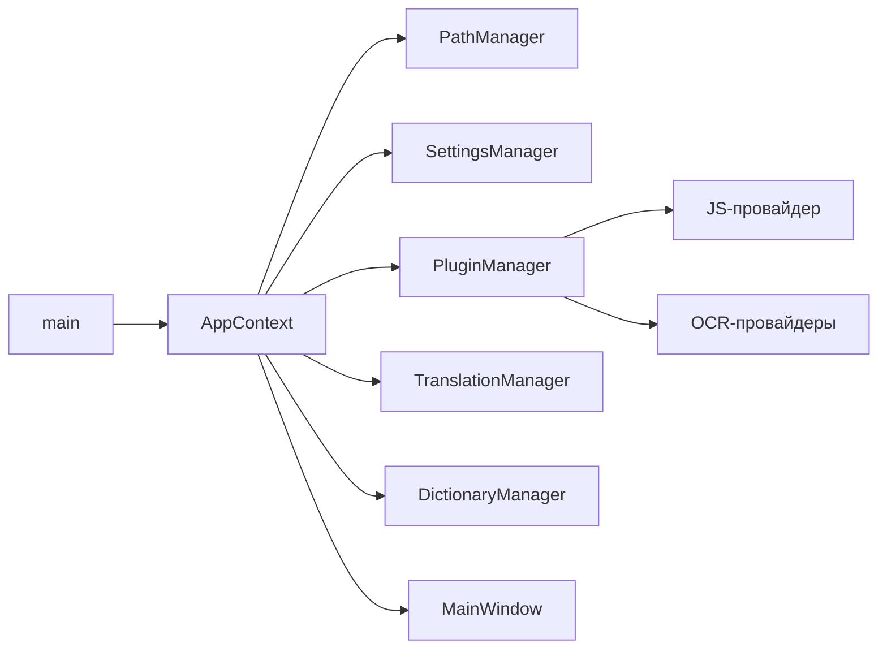

# Архитектура

[README](../README_rus.md) · [Интерфейс](INTERFACE.ru.md) · [Коннекторы](CONNECTORS.ru.md) · [English](ARCHITECTURE.md)

## Цели

Q2Translate — портативный переводчик для Windows. Архитектура оптимизирована под:

- автономный ZIP-дистрибутив;
- предсказуемый интерфейс на Qt Widgets;
- коннекторы, которые добавляются и меняются без пересборки приложения;
- сохранность пользовательских данных и исходных документов;
- чёткое разделение перевода, обработки документов, словарей и представления.

Стек: **C++20**, **Qt 6.8.3 Widgets**, **MinGW 13.1**, **CMake 3.30.5**, **Ninja 1.12.1**. Инструменты подготавливаются скриптом `tools/download_toolchain.ps1` в `.toolchain/`; в Git они не хранятся.

## Карта модулей

```text
src/
  main.cpp                  точка входа, диагностические режимы
  core/                     настройки, пути, JSON-хранилище, языки, перевод, история
  services/                 менеджер плагинов, JS/HTTP-мосты, OCR-, TTS- и орфографические провайдеры
    spell_provider_base.*   общая реализация Hunspell/Nuspell
  modules/
    dictionary/             XDXF и менеджер словарей
    document/               чтение документов и задания перевода
  platform/win/             буфер обмена, глобальные горячие клавиши, речь
  ui/                       главное окно, popup, словарь, история, настройки
    theme_manager.*         загрузка тем и подстановка токенов
resources/                  style.qss, themes.json, иконки, манифест
data/
  services/                 поставляемые коннекторы и данные OCR/орфографии
  Themes/                   General/ — темы приложения, Popup/ — стили попапа
  Locales/                  переводы интерфейса (17 языков)
third_party/
  pdfium/                   извлечение текста и рендер PDF (BSD-3-Clause)
  yaml-cpp/                 парсер YAML (MIT)
  nuspell/                  Nuspell 5.1.9: заголовки, DLL и LGPL-лицензия
  icu/                      ICU 76: Unicode-рантайм и заголовки для Nuspell
  qt/                       тексты лицензий Qt (LGPL-3.0, GPL-3.0) и уведомление
  tesseract/                текст лицензии Apache-2.0 для Tesseract
  mingw-runtime/            уведомление об исключении для рантайма GCC
```

CMake копирует `settings-default.json` и содержимое `data/` рядом с exe, поэтому во время работы `services/`, `Themes/` и `Locales/` читаются из папки приложения.

## Запуск

1. `main.cpp` создаёт `QApplication`, применяет сохранённую тему и `AppContext`.
2. `PathManager` выбирает портативный режим (`portable.txt` рядом с exe) или `%APPDATA%/Q2Translate/Data`.
3. `SettingsManager` читает `Data/settings.json` и дополняет его значениями из `settings-default.json`.
4. `PluginManager` сканирует `services/` и `Data/services/`, разбирает манифесты и создаёт провайдеры.
5. `LanguageRouter`, `TranslationManager`, `HistoryManager`, `DictionaryManager`, `ExceptionsManager` подключаются к `AppContext`.
6. `MainWindow` строит интерфейс, восстанавливает состояние и применяет тему.



## Настройки и данные

- `SettingsManager` хранит вложенные ключи (`General.MinimizeAction`, `General.LanguageDetection`, `Appearance.ThemeName`, `Internet.Timeout`).
- `settings-default.json` задаёт значения по умолчанию; отсутствующие ключи добавляются без перезаписи пользовательских.
- Одноразовые миграции сохраняют старые профили (действия сворачивания/закрытия, профиль горячих клавиш, удалённые пресеты).
- Настройки коннекторов: `Data/services/<id>/`; поставляемые настройки только для чтения.
- История по умолчанию ограничена 50 записями (`Application.HistoryLimit`).
- Исключения и пользовательские словари хранятся отдельно от настроек.

## Данные

Всё, что пишет приложение, лежит в корне данных (`Data/` рядом с exe в портативном режиме, иначе `%APPDATA%/Q2Translate/Data`):

| Путь | Содержимое |
|---|---|
| `settings.json` | Пользовательские настройки поверх `settings-default.json`. |
| `services/<id>/settings.json` | Настройки коннекторов (API-ключи, endpoint, модели). |
| `History.json` | История переводов (массив `History`, лимит `Application.HistoryLimit`). |
| `DictionaryHistory.json` | Последние 30 словарных запросов. |
| `Exceptions.json` | Исключения для горячих клавиш и mouse mode. |
| `selftest.log` | Полный вывод `--selftest`. |
| `connector_probe.log` | Результаты `--probe-connectors`, по строке на возможность. |
| `tts_probe.log` / `http_probe.log` | Результаты `--tts-test` и `--http-test`. |
| `Logs/` | Создаётся при старте под диагностический вывод. |

## Система коннекторов

Коннектор — папка с `manifest.json`, `service.js`, иконкой и приватными файлами:

```text
services/translate/google_translate/
  manifest.json
  service.js
  icon.png
```

Поля манифеста: `id`, `name`, `type`, `engine`, `capabilities`, `settings_schema`, `link`, `service_script`. Движок: `javascript` или `native` (например, локальный XDXF-словарь). Для нативных коннекторов используется `native_provider` или `native_executable`.

`PluginManager`:

1. сканирует поставляемые и пользовательские каталоги;
2. разбирает манифесты и пути к иконкам/скриптам;
3. создаёт `JsPluginProvider` для JavaScript-коннекторов и соответствующий нативный провайдер для `spelling`, `tts`, `ocr` и `dictionary`;
4. отдаёт провайдеры по возможностям (`translate`, `dictionary`, `ocr`, `spelling`, `tts`, `llm`);
5. пользовательские коннекторы в `Data/services` переопределяют поставляемые по id;
6. использует `DisabledServices` как единый источник состояния по умолчанию; `enabled_by_default` в манифестах с ним согласован.

Полная схема манифеста, справочник API песочницы (`http`, `qtranslate`, контракт результата), значения нативных провайдеров и разобранный пример — в [Коннекторы](CONNECTORS.ru.md).

## JavaScript-мост

`JsPluginProvider` создаёт отдельный `QJSEngine` на запуск и устанавливает:

- `http` → `HttpBridge` (`get`, `post`, `multipart_post`) с общим cookie-jar процесса;
- `qtranslate` → `JsBridge` (`loadJSON`, `md5`, `aesDecryptBase64`, `cacheGet`, `cacheSet`);
- скрипт коннектора.

Сеть идёт только через `QNetworkAccessManager`; коннекторы не получают прямой доступ к файлам. AES-расшифровка — Windows CNG (`bcrypt`). Внутрипроцессный кэш общий для запусков одного коннектора и используется для короткоживущих токенов и ключей. `loadJSON()` читает локальные JSON-файлы коннектора, включая `prompts.json` и `manifest.json`; общие реализации используют его для выбора хоста и режима.

`HttpBridge` возвращает на каждый вызов `{status, body, body_base64, content_type, error}`. Таймауты (`Internet.Timeout`, `ConnectTimeout`, `DataTimeout`), повторы (`RetryFailed`, `RetryCount`, `RetryDelay`) и прокси (`Proxy.*`: системный, ручной с авторизацией или без прокси) берутся из настроек и одинаково действуют для всех коннекторов.

## Модель потоков

- `JsPluginProvider::executeAsync()` выполняет весь скрипт в рабочем потоке `QtConcurrent` и возвращает результат в поток UI через `QFutureWatcher`, поэтому медленный коннектор не блокирует ни интерфейс, ни остальные коннекторы.
- HTTP-мост синхронен для скрипта, но управляется локальным `QEventLoop` с настроенными таймаутами; проверка TLS никогда не отключается.
- Поиск по XDXF идёт в рабочем потоке `QtConcurrent` (`DictionaryManager::searchLocalAsync`).
- Проверки выполняются в главных событийных циклах с жёсткими таймаутами: 12 с на коннектор в `--probe-connectors`, 45 с на этап в `--selftest`, 30 с в `--tts-test`.
- Голосовой ввод запускает скрытый процесс PowerShell (`System.Speech`) и подставляет распознанный текст в редактор исходника.

## Поток перевода

1. `MainWindow::onTranslate()` собирает текст, языки и выбранные сервисы.
2. `TranslationManager` читает `General.LanguageDetection`:
   - `local` — определяет `auto` через `LanguageRouter` до запроса и использует это значение для UI и истории;
   - `service` — отправляет `auto` коннектору и сохраняет его `detected_lang` в результате.
3. `TranslationManager` формирует параметры и асинхронно вызывает каждый выбранный провайдер; медленный коннектор не блокирует остальные.
4. Результаты приходят как `serviceResult`; при нескольких сервисах UI создаёт вкладки.
5. Успешный перевод пишется в историю, если она включена.
6. Popup использует тот же менеджер и активные сервисы.

## Дополнительные вызовы и LLM

- После перевода `MainWindow` может выполнить дополнительный вызов (`General.AdditionalCall`): `back` (обратный перевод через `translate`), `summ` (`summarize`) или `rewr` (`paraphrase`). Провайдер берётся из `ServiceProviders.summ`/`rewr` или `General.AdditionalCallProvider`, иначе — первый подходящий коннектор.
- LLM-коннекторы объявляют возможности `translate`, `summarize`, `paraphrase`, `dictionary` и `ocr_vision`. Промпты лежат в `prompts.json` каждого коннектора с плейсхолдерами `{source}`, `{target}`, `{text}` и загружаются через `loadJSON()`.
- `General.AdditionalOutputType` включает автоматический вывод после перевода — озвучить, скопировать в буфер или показать во всплывающем окне — для перевода или исходного текста (`General.AdditionalOutputSource`).

## Глобальный ввод

- Назначенные горячие клавиши регистрируются через `RegisterHotKey`; по умолчанию это `Ctrl+Q` (быстрый перевод) и `Win+Shift+Q` (OCR).
- Низкоуровневый хук `WH_KEYBOARD_LL` распознаёт двойной `Ctrl`, поднимающий главное окно; `HotKeys.Preset` содержит наборы `classic` и `modern`.
- Низкоуровневый хук `WH_MOUSE_LL` реализует mouse mode (`Advanced.EnableMouseModeOnCtrl`): зажатый `Ctrl` + выделение мышью переводят текст.
- `ExceptionsManager` хранит в `Data/Exceptions.json` приложения и классы окон, где горячие клавиши и mouse mode не работают; записи сопоставляют имя процесса и необязательный класс окна без учёта регистра, списки отключённых и включённых раздельны.

## Перевод документов

`DocumentTranslationJob` — общий конвейер:

1. парсер выбирается по расширению;
2. извлекаются сегменты и сохраняется callback записи;
3. сегменты последовательно переводятся первым активным сервисом;
4. результат сохраняется рядом: `<имя>.<язык>.<расширение>`.

| Семейство | Парсер / запись | Сохранение |
|---|---|---|
| DOCX, PPTX | Qt XML + ZIP | QDom-дерево, текст распределяется по исходным run |
| PDF | PDFium + `QPdfWriter` | рендер страницы, фон скрывает оригинал, перевод в исходных блоках |
| Скан PDF | рендер PDFium + OCR + `QPdfWriter` | страницы без текстового слоя выравниваются и распознаются постранично, выровненный растр становится фоном страницы |
| DJVU | внешний `ddjvu.exe` + путь сканов | файл сначала конвертируется в растровый PDF, затем распознаётся как скан |
| Изображение (PNG, JPEG, …) | OCR + `image_overlay` | блоки переводятся целиком и рисуются обратно в свои рамки |
| FB2 | QDomDocument | текстовые узлы абзацев, подзаголовков, строк стихов |
| EPUB | QZip + HTML-токенайзер | XHTML-узлы; CSS/картинки не меняются; `mimetype` первый и без сжатия |
| XLIFF/XLF, TS | QDomDocument | source/target, inline-элементы клонируются |
| JSON | токенайзер на месте | только строковые значения; ключи/порядок/отступы сохраняются |
| XML | токенайзер на месте | только текстовые узлы; теги, атрибуты, CDATA, комментарии сохраняются |
| Properties, INI | построчный парсер | только значения; ключи, секции, комментарии сохраняются |
| YAML/YML | yaml-cpp | скалярные значения; валидный YAML на выходе |
| SRT, VTT | парсер cue | таймкоды/индексы сохраняются; текст переводится блоком |
| ASS/SSA | парсер `[Events]` | только текст `Dialogue:`; теги `{\...}` и `\N` защищены |
| CSV | RFC 4180 | поля, разделитель, кавычки и многострочные значения сохраняются |
| TXT, Markdown, HTML | текстовый/токенный парсер | переводы строк, блоки Markdown, теги/script/style сохраняются |

Исходный файл открывается только для чтения. Результат пишется во временный файл и заменяет целевой только после успешного разбора и перевода.

## Темы

`ThemeManager` читает встроенный ресурс `:/themes.json` как базовую палитру и объединяет его с `Themes/General/*.json` рядом с exe. Стили попапа загружаются из `Themes/Popup/*.json`. Ключ — `name`: внешний файл переопределяет встроенную тему. В `style.qss` токены `$token` заменяются цветами темы.

Формат файла:

```json
{
  "name": "Fusion Dark",
  "dark": true,
  "bg": "#141a21",
  "surface": "#1a2129",
  "accent": "#4da3ff"
}
```

При открытии настроек список перечитывается; активная тема применяется при сохранении, иначе достаточно перезапуска.

`ThemeScheduleController` переключает темы по временным интервалам из `Appearance.ThemeSchedule`, а `Appearance.SyncWithSystemTheme` следует за светлым/тёмным режимом Windows. Инвентарь палитры и шкала отступов задокументированы в `design/tokens-colors.md` и `design/spacing-scale.md`; `tools/audit_contrast.ps1` и `tools/audit_soft.ps1` проверяют все темы на контраст по WCAG.

## Локализация

`Locales/<Язык>.json` — словарь английских строк и переводов поверх встроенной английской базы (`:/lang-base.json`). `Localization::load()` читает его при запуске и после изменения настроек; `Localization::install()` переводит тексты виджетов, заголовки, меню, элементы списков, вкладки и заголовки таблиц при показе и по лёгкому таймеру. Неизвестные строки остаются на английском, поэтому частичный файл не ломает интерфейс. Все файлы `*.json` сканируются прямо в `Locales/`; подкаталог для каждого языка не нужен, а старый вариант `Locales/<Язык>/lang.json` по-прежнему загружается.

English и Russian — эталонные локали; новый язык добавляется копированием JSON-файла и переводом значений.

## OCR

- `WindowsOcrProvider` использует `Windows.Media.Ocr`.
- `TesseractProvider` запускает Tesseract из полной сборки или из установленного пакета движка; его `tessdata` лежит в `services/ocr/tesseract/tessdata`.
- `PaddleOcrProvider` запускает модели PP-OCRv5 через `onnxruntime.dll` из `services/ocr/paddleocr/` (в полной сборке движок встроен, в урезанной устанавливается по запросу).

В урезанной сборке нет Tesseract и PaddleOCR: каталоги `services/ocr/tesseract` и `services/ocr/paddleocr` удалены, пакеты движков ставятся в `Data/services`, а OCR по умолчанию — Windows OCR.

- `ocr_layout` разбирает выдачу TSV на текст, строки и рамки слов и собирает Markdown-таблицу по сетке слов.
- `image_deskew` измеряет перекос по дисперсии проекционного профиля на уменьшенной копии и поворачивает страницу обратно до распознавания; штатная сегментация после этого сохраняет порядок колонок и строки таблиц.
- `bubble_detector` выращивает пузырь от распознанных строк (`BubbleFinder`) и отдаёт маску с профилем ширины по строкам; `text_typesetter` верстает перевод по этому профилю, а `image_overlay` затирает оригинал и рисует строки по центрам интервалов; всё это использует `ImageTranslationPipeline`.
- `ImageTranslationPipeline` распознаёт изображение, переводит каждый блок целиком (один блок = один пузырь) и возвращает готовую картинку; его используют вставка из буфера и окно пакетной обработки.
- `ScreenCaptureWindow` даёт выбор области; `MainWindow` передаёт изображение в `TranslationManager::ocrAsync`.

### Активация окна захвата экрана (не менять)

Оверлей OCR — окно без рамки поверх всех окон, открываемое по горячей клавише, когда главное окно может быть свёрнуто в трей. Оно обязано выйти на передний план до первого события мыши:

- обрабатывать `WM_MOUSEACTIVATE` с `MA_ACTIVATE`;
- вызывать `QWindow::requestActivate()`, `raise()`, `activateWindow()`, `setFocus()`;
- в Windows использовать `AttachThreadInput` + `SetForegroundWindow` / `SetActiveWindow` / `SetFocus`;
- повторять активацию через 0, 30, 150 и 500 мс.

Без этого Windows «съедает» первое выделение и клики по панели, пока активирует окно. Не заменяйте обычный `show()` на `showFullScreen()` и не удаляйте нативную активацию и повторы. После любых изменений проверяйте первый запуск: открыть OCR по глобальной горячей клавише, сразу выделить область и нажать кнопку на панели.

### Конвейер распознавания (PaddleOCR, сложные страницы)

1. **Выравнивание.** Проекционный профиль уменьшенной копии (700 px) сканируется от −10° до +10° шагом 1° с уточнением 0,25°; страница поворачивается обратно на белом холсте. От ~3° наклона движок склеивает строки соседних колонок, после 5° не читает ничего, поэтому правка делается до распознавания. Ровные снимки дают ноль и поворот пропускают.
2. **Распознавание.** Штатная сегментация читает страницу целиком, рамки слов возвращаются вместе с текстом.
3. **Фильтрация.** Строки с меньшим количеством букв, чистые числа, одиночные символы и смеси букв с цифрами отбрасываются — это номера страниц и мусор от рисунка, а не реплики.
4. **Группировка.** Строки собираются в блоки: по объёмлющему пузырю, если он найден, иначе по горизонтальному перекрытию и вертикальному зазору. Два соседних пузыря на одной базовой линии становятся двумя блоками, а блок на четверть страницы пропускается как ошибка группировки.
5. **Повтор.** Если проход не дал читаемого текста, он повторяется сегментацией единым блоком (`psm 6`), а портретная страница — с поворотом на 90° и пересчётом рамок: у вертикального CJK нет горизонтальных базовых линий.
6. **Таблицы.** При трёх и более выровненных колонках блок собирается как Markdown-таблица вместо перемешанного текста.
7. **Вывод.** `text`, `lines[]` с `block/paragraph/line`, `table_markdown` и `coordinate_space` образуют контракт, который используют `ImageTranslationPipeline`, задание документов и overlay.

### Сканы PDF и DJVU

Задание документов сначала извлекает текстовый слой (PDFium для PDF, `djvutxt.exe` для DJVU) и проверяет его качество: минимальная длина, доля букв и пробелов, счётчик `U+FFFD`. Хороший слой переводится напрямую; отсутствующий или битый переключает на постраничный рендер, `image_deskew` с холстом исходного размера, распознавание, и выровненный растр становится фоном страницы — рамки слов и изображение живут в одном координатном пространстве.
- `ScreenCaptureWindow` даёт выбор области; `MainWindow` передаёт изображение в `TranslationManager::ocrAsync`.
- Результат можно вставить в редактор или отправить на перевод.

## Орфография

Орфографические коннекторы реализуют `ISpellProvider` дополнительно к `IPluginProvider`. `HunspellProvider` и `NuspellProvider` используют общий `SpellProviderBase`; различается только `createEngine()`:

- `HunspellProvider` читает словари `.aff`/`.dic` через `HunspellEngine` — небольшой парсер без внешних зависимостей: режимы флагов, алиасы, IGNORE, запрещённые/требующие аффикса слова, правила префиксов и суффиксов с cross-product.
- `NuspellProvider` оборачивает Nuspell 5.1.9 через `NuspellEngine`; использует ту же папку словарей, поддерживает составные слова и богатую морфологию, возвращает качественные подсказки. Для Nuspell нужен ICU 76 — в поставку входят `cygicuuc76.dll` и `cygicudata76.dll`.
- `WindowsSpellProvider` использует Windows Spell Checking API и отдаёт системный список языков, включая подсказки.
- `SpellService` выбирает коннектор из `ServiceProviders.spell`, определяет `Auto` по кириллице/латинице/греческому/ивриту/арабскому, а `SpellCheckHighlighter` проверяет слова в редакторе исходника. Без словаря текст не подчёркивается.
- Словари лежат в папке коннектора и скачиваются/удаляются из окна языков. Английский и русский словари уже включены; остальные языки скачиваются по запросу.
- `MainWindow::showSourceContextMenu()` показывает подсказки коннектора вверху контекстного меню и заменяет слово при выборе.

## Словари

`DictionaryManager` загружает XDXF-файлы из списка `OfflineDictionaries` и опрашивает включённые онлайн-коннекторы с возможностью `dictionary`. Локальные файлы добавляются и удаляются в окне словаря.

Нативный коннектор `local_xdxf` (`XdxfProvider`) рекурсивно ищет `.xdxf` в своей папке или в подпапке, выбранной в настройке `folder`. Каждая подпапка, где есть хотя бы один словарь, появляется как доступный вариант:

```text
services/dictionaries/local_xdxf/
services/dictionaries/local_xdxf/<вариант>/
```

XDXF-словари не входят в поставку: пользователь скачивает их отдельно. `XdxfDictionary` разбирает XML и ищет по заголовкам. Онлайн-словари — обычные коннекторы с возможностью `dictionary`. `dic_academic` и `translate_academic` используют общий `data/services/dictionaries/academic_common/service.js`; хост и режим задаются в манифестах.

## Сборка и упаковка

`tools/deploy_portable.ps1`:

1. собирает Release в `work/`;
2. запускает `windeployqt` в `work/package/`;
3. копирует `services/`, `Themes/`, `Locales/`, `settings-default.json`;
4. копирует `pdfium.dll`, DLL Nuspell/ICU и тексты лицензий (LGPL/GPL для Qt, Nuspell, ICU, PDFium с вложенными лицензиями, yaml-cpp, Apache-2.0 для Tesseract, уведомление о рантайме MinGW, `THIRD_PARTY_NOTICES.md`);
5. удаляет неиспользуемые QML-компоненты;
6. создаёт `build/Q2TranslatePortable_full_v<версия>.zip` и `build/Q2TranslatePortable_small_v<версия>.zip`; версия берётся из `project(... VERSION ...)`, и скрипт упаковки повышает номер патча при каждой сборке.

В каталоге сборки также есть всегда выполняемая цель `sync_runtime_data`, которая копирует `data/Locales` и `data/Themes`: новые локали и темы появляются без перелинковки exe.

Диагностические и автоматизационные режимы: `--selftest`, `--probe-connectors`, `--tts-test`, `--http-test`, `--translate-document`, `--translate`, `--set-source`, `--popup-text`, `--plugin-settings`, `--ocr-languages`, `--selection-test`, `--show-options`, `--show-dictionary`, `--show-history`, `--show-popup`, `--start-ocr`. Логи проверок пишутся в корень данных (см. [Данные](#данные)).

## Безопасность и приватность

- Коннекторы работают только через HTTP-мост; TLS-проверка не отключается.
- API-ключи хранятся в `Data/services/<id>/settings.json` и не попадают в логи.
- История и буфер обмена остаются локальными, пока не используется сетевой коннектор.
- Документы сохраняются под новым именем; исходник не изменяется.
- Пароли PDF не обходятся: зашифрованный документ завершается понятной ошибкой.
