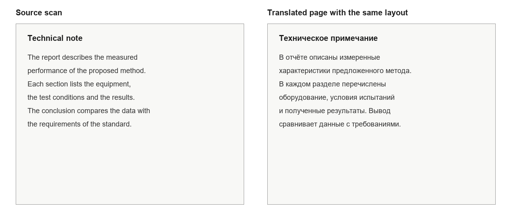
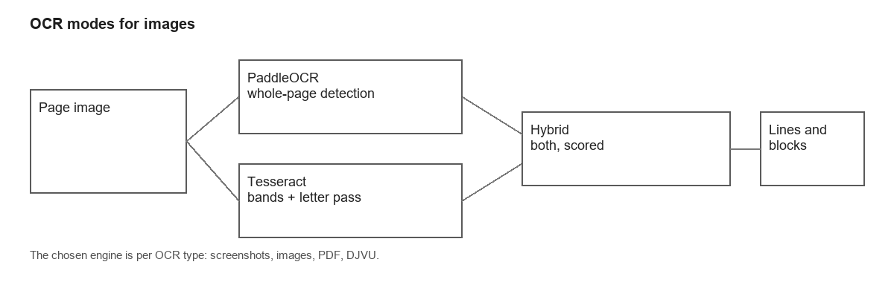
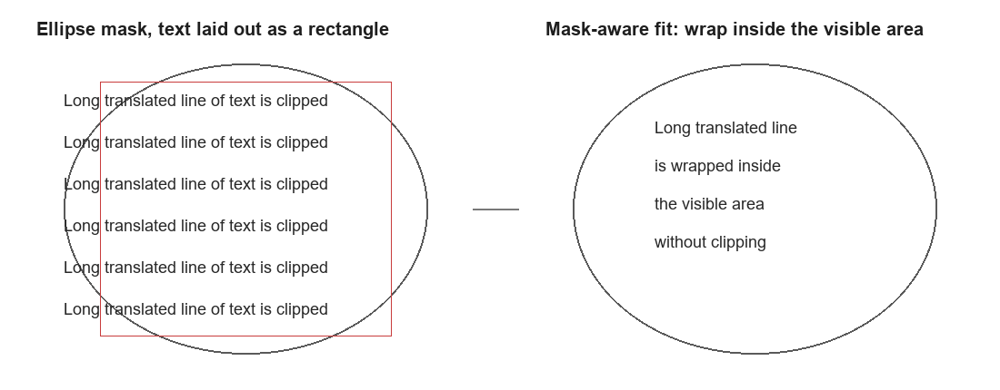
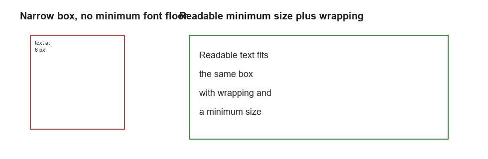
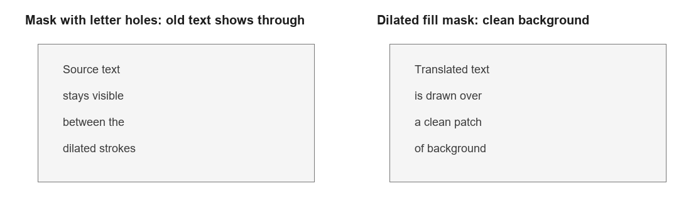

# Image Text Translation Quality: Pipeline, Typesetting, Diagnostics

This document explains how Q2Translate translates text on images and scans:
from page preparation and OCR to typesetting the translation and measuring quality.
The examples intentionally use documents, diagrams, and interface screenshots
rather than illustrated artwork.

## 1. What Counts as an Image

- screenshots of interfaces, presentations, and web pages;
- photos of signs, notices, and documents;
- scans of books, articles, and forms;
- PDF and DJVU pages without a usable text layer.

For PDF and DJVU the text layer is checked first. When it is readable, OCR is
skipped: the text is extracted directly and keeps the original layout more
accurately.

## 2. Pipeline

### 2.1. An Image as a Single Page

1. Preparation: scaling, optional deskew, grayscale conversion.
2. OCR: PaddleOCR, Tesseract, or the hybrid mode.
3. Lines → blocks: geometric grouping and merging into paragraphs.
4. Masks: for every block the light region that contains it is located.
5. Translation: the whole block, with names and numbers protected.
6. Typesetting: font fitting, wrapping, alignment, erasing the original.

### 2.2. PDF and DJVU Documents

- A readable text layer is used directly; lines are merged into paragraphs.
- Scans are rendered to an image and passed through OCR; DPI is selected
  automatically from the native resolution of the embedded image: 200 DPI by
  default, up to 300 DPI for high-resolution scans.
- DJVU pages without a text layer are converted through `ddjvu`; after that the
  path matches scanned PDF.

## 3. Recognition

### 3.1. OCR Modes

| Mode | When it is used |
|---|---|
| PaddleOCR (local) | images, screenshots, pages with artwork; confident line detection |
| Tesseract (local) | documents, scans, text on a uniform background |
| Hybrid | Paddle finds the page, Tesseract re-reads areas without lines |
| Windows OCR | system engine without installing components |

The engine is chosen per type: screenshots, images, PDF, DJVU. This makes it
possible to read book scans with Tesseract and pages with artwork with PaddleOCR
without changing settings each time.

### 3.2. Page Preparation

- exact luminance (0.299/0.587/0.114) rather than the channel average;
- contrast normalization over the histogram;
- removal of isolated dark dots without damaging strokes;
- deskewing of tilted scans;
- upscaling of small pages before OCR.

### 3.3. Recognition Parameters

- Tesseract: PSM 6 for a book-like block; if confidence is low, a second pass with
  PSM 3 is run and the better result is selected.
- If both passes are weak, the page is additionally read by PaddleOCR and the
  results are compared by confidence and text volume.
- A two-column page is recognized column by column: the gutter is detected first,
  then each column is read separately so lines are not merged across the gutter.
- Lines with low confidence and no dictionary words are dropped; a page with no
  result is translated from the source lines instead of being skipped.
- Hyphenation at line boundaries is repaired: `neu-` + `ron` → `neuron`.
- OCR results are cached by page content, language, profile, and DPI.

### 3.4. OCR Components

OCR engines are shipped as separate components. When an engine is not installed,
its connector card reports that state and offers to download the package; Windows
OCR is always available. This allows a lightweight build without Tesseract and
PaddleOCR.

## 4. Blocks and Masks

- Lines are grouped into blocks by distance and overlap; blocks of one paragraph
  are merged, while lists and headings ending with a colon are not.
- A light region bounded by a contour is located for each block. The mask is used
  both to erase the original and to lay out the translation.
- If the contour is not closed, a synthetic region is built from the block lines.
- Oversized text regions and areas without text are rejected so that artwork is
  not painted over.

## 5. Typesetting the Translation

### 5.1. Fitting Text

- The font size is fitted to the mask width and height; the minimum size is
  `Image.MinFontPx`.
- The longest word is taken into account: it must not leave the block bounds.
- If the text does not fit, the block grows downward but does not overlap the next
  block.
- Lines are justified; short lines in the middle of the page are treated as
  headings and centered.

### 5.2. Erasing the Original

- `auto` — flat fill for a uniform background, smoothing for a soft gradient,
  diffusion fill for artwork;
- `fill`, `smooth`, `inpaint` — forced modes;
- the mask is dilated so strokes of the old letters do not show between the new
  ones.

### 5.3. Typography

- one font size per paragraph;
- line spacing derived from the font size rather than Qt metrics;
- justification for body text;
- bold and italic preserved from a PDF text layer;
- captions and running heads are translated separately and are not merged into a
  paragraph.

## 6. Translation

- A block is translated as a whole, not line by line: this preserves context.
- Names and abbreviations are not corrected by the dictionary.
- Numbers, units, and references are protected from changes.
- Long paragraphs are limited by a character budget; LLM context can be enabled
  when needed.
- The translation connector is selected separately for PDF, DJVU, images, and
  screenshots.
- The balancer walks through enabled connectors on error or timeout.

## 7. Diagnostics

The `--image-layout-dump <file.json>` flag records:

- `ocrLines`, `blocks`, typesetting statuses, font size, overflow;
- `<dump>.masks.png` — masks over the page;
- `<dump>.blobs.png` — accepted and rejected letter blobs;
- `<dump>.clusters/` — cluster images for manual inspection.

Metrics over a set of dumps are computed by `tools/image_quality_metrics.ps1`:

- number of pages, blocks, and lines;
- share of blocks inside masks;
- blocks without a fitting font size (`no-fit`);
- overflows;
- too-small text;
- share of missed lines.

These metrics do not replace visual review, but they allow builds and settings to be
compared on the same set of pages.

## 8. Settings

| Key | Purpose |
|---|---|
| `Ocr.ProviderScreen`, `ProviderImages`, `ProviderPdf`, `ProviderDjvu` | OCR engine per type |
| `Ocr.DocumentDpi` | DPI for scans: 0 — auto, otherwise 150–400 |
| `Ocr.OcrLanguage` | Tesseract languages |
| `ServiceProviders.translateScreen/Images/Pdf/Djvu` | translation connector per type |
| `ServiceProviders.fileTranslate` | default connector for files |
| `Image.MinFontPx` | minimum font size |
| `Image.MaxLines` | maximum lines per block |
| `Image.LineSpacing` | line spacing |
| `Image.EraseMode` | `auto`, `fill`, `smooth`, `inpaint` |
| `Image.TextOutline` | text outline on busy backgrounds |
| `Image.MinOcrConfidence` | OCR confidence threshold |
| `Image.RecoverMissedText` | re-read missed words |
| `Image.TileLargePages` | tiles for large pages |
| `Image.BubblePass` | experimental letter pass |

## 9. Limitations

- Stylized and handwritten text is recognized worse than printed text.
- Small text on a busy background may require manual correction.
- Mixed pages (text and artwork in the same area) sometimes produce extra blocks.
- Running heads and page numbers are currently translated as ordinary text.
- Vector PDF content is rasterized on output; preserving the vector layer is a
  separate task.
- Very large books take time: OCR is processed page by page.

## 10. Current Status

- masks and text fitting to the contour — implemented;
- minimum font size, wrapping, and overlap protection — implemented;
- justification and heading centering — implemented;
- column-wise OCR, dehyphenation, and paragraph typesetting — implemented;
- automatic DPI and scan preprocessing — implemented;
- OCR cache and diagnostic dumps — implemented;
- the engine block in the connector card (Download / Update / Delete) — implemented, installing from the bundled package; a network source is the next step.
