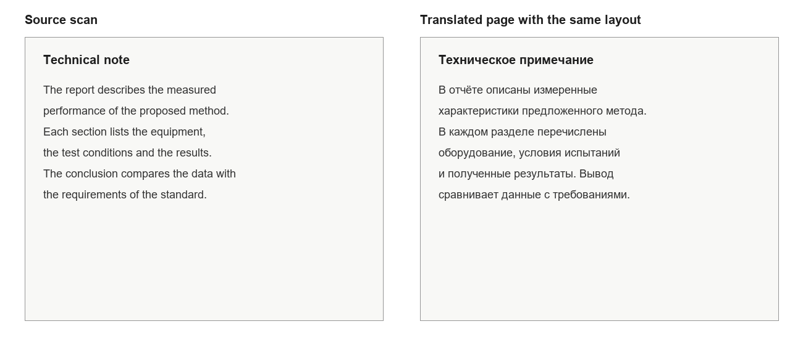
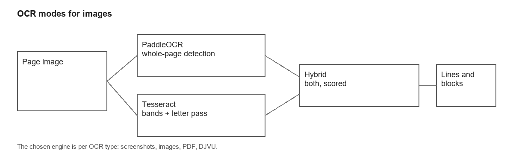
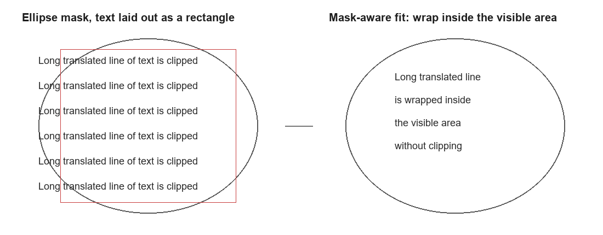
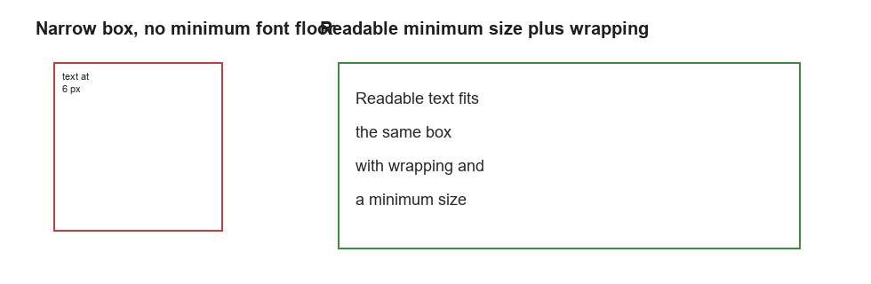
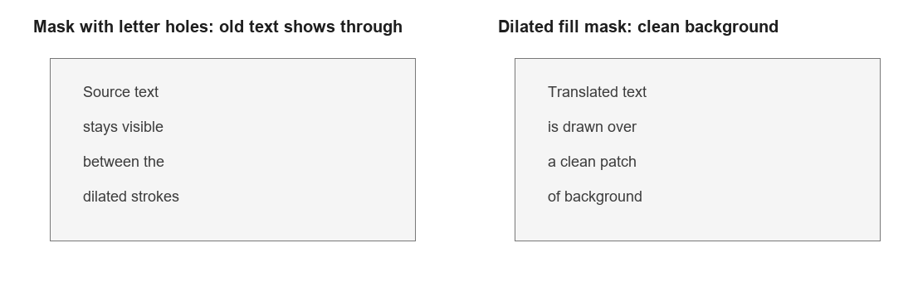

# Качество перевода текста на изображениях: конвейер, вёрстка, диагностика

Документ описывает, как Q2Translate переводит текст на изображениях и
сканах: от подготовки страницы и OCR до вёрстки перевода и диагностики качества.
Примеры намеренно построены на документах, схемах и интерфейсных скриншотах, а не
на художественных страницах.

## 1. Что считается изображением

- скриншоты интерфейсов, презентаций и веб-страниц;
- фотографии вывесок, объявлений и документов;
- сканы книг, статей и бланков;
- страницы PDF и DJVU без пригодного текстового слоя.

Для PDF и DJVU сначала проверяется текстовый слой. Если он читаемый, OCR не
запускается: текст извлекается напрямую и сохраняет исходную вёрстку точнее.

## 2. Конвейер

### 2.1. Изображение как единая страница

1. Подготовка: масштаб, при необходимости выравнивание, перевод в оттенки серого.
2. OCR: PaddleOCR, Tesseract или гибридный режим.
3. Строки → блоки: группировка по геометрии и объединение в абзацы.
4. Маски: для каждого блока ищется светлая область, в которую он вписан.
5. Перевод: блок целиком, с защитой имён и чисел.
6. Вёрстка: подбор кегля, переносы, выравнивание, затирание оригинала.

### 2.2. Документы PDF и DJVU

- Читаемый текстовый слой используется напрямую; строки объединяются в абзацы.
- Сканы рендерятся в изображение и проходят OCR; DPI выбирается автоматически по
  родному разрешению встроенной картинки: 200 DPI по умолчанию, до 300 DPI для
  сканов высокого разрешения.
- Для DJVU без текстового слоя страницы конвертируются через `ddjvu`, дальше путь
  совпадает со сканами PDF.

## 3. Распознавание

### 3.1. Режимы OCR

| Режим | Когда используется |
|---|---|
| PaddleOCR (локальный) | изображения, скриншоты, страницы с рисунком; уверенная детекция строк |
| Tesseract (локальный) | документы, сканы, текст на однородном фоне |
| Гибрид | Paddle находит страницу, Tesseract дочитывает места без строк |
| Windows OCR | системный движок без установки компонентов |

Движок выбирается отдельно для каждого типа: скриншоты, изображения, PDF, DJVU.
Это позволяет переводить сканы книг Tesseract-ом, а страницы с рисунком —
PaddleOCR, не меняя настройки каждый раз.

### 3.2. Подготовка страницы

- точная яркость (0.299/0.587/0.114), а не среднее по каналам;
- контрастная нормализация по гистограмме;
- удаление изолированных тёмных точек без повреждения штрихов;
- выравнивание перекошенных сканов;
- апскейл мелких страниц перед OCR.

### 3.3. Параметры распознавания

- Tesseract: PSM 6 для книжного блока; если уверенность низкая — повтор с PSM 3 и
  выбор лучшего результата.
- Если оба прохода слабые, страница дополнительно читается PaddleOCR и результаты
  сравниваются по уверенности и объёму текста.
- Двухколоночная страница распознаётся по колонкам: сначала определяется разрыв,
  затем каждая колонка читается отдельно, чтобы строки не склеивались через
  межколоночный интервал.
- Строки с низкой уверенностью и без словарных слов отбрасываются; страница без
  результата переводится по исходным строкам, а не пропускается.
- Переносы на границе строк склеиваются: `ней-` + `рон` → `нейрон`.
- Результат OCR кэшируется по содержимому страницы, языку, профилю и DPI.

### 3.4. Компоненты OCR

Движки поставляются как отдельные компоненты. Если движок не установлен, коннектор
показывает это в карточке и предлагает скачать пакет; Windows OCR доступен всегда.
Это позволяет выпускать облегчённую сборку без Tesseract и PaddleOCR.

## 4. Блоки и маски

- Строки объединяются в блоки по расстоянию и перекрытию; блоки одного абзаца
  склеиваются, списки и заголовки с двоеточием — нет.
- Для блока ищется светлая область, ограниченная контуром. Маска используется и
  для затирания оригинала, и для вёрстки.
- Если контур не замкнут, строится синтетическая область по строкам блока.
- Слишком крупные текстовые области и участки без текста отбрасываются, чтобы не
  заливать рисунок.

## 5. Вёрстка перевода

### 5.1. Вписывание текста

- Кегль подбирается под ширину и высоту маски; минимальный размер — `Image.MinFontPx`.
- Учитывается самое длинное слово: оно не должно выходить за границы блока.
- Если текст не влезает, блок расширяется вниз, но не наезжает на следующий блок.
- Строки выравниваются по ширине; короткие строки по центру страницы считаются
  заголовками и центрируются.

### 5.2. Затирание оригинала

- `auto` — плоская заливка для однородного фона, сглаживание для мягкого градиента,
  диффузионное заполнение для рисунка;
- `fill`, `smooth`, `inpaint` — принудительные режимы;
- маска расширяется, чтобы штрихи старых букв не просвечивали между новыми.

### 5.3. Типографика

- единый кегль на абзац;
- межстрочный шаг от кегля, а не от метрик Qt;
- выключка по ширине для основного текста;
- сохранение жирности и курсива из текстового слоя PDF;
- подписи и колонтитулы переводятся отдельно и не смешиваются с абзацем.

## 6. Перевод

- Блок переводится целиком, а не по строкам: это сохраняет контекст.
- Имена и аббревиатуры не исправляются словарём.
- Числа, единицы и ссылки защищаются от изменения.
- Для длинных абзацев действует бюджет символов; при необходимости включается
  LLM-контекст.
- Коннектор перевода выбирается отдельно для PDF, DJVU, изображений и скриншотов.
- Балансировщик обходит включённые коннекторы при ошибке или таймауте.

## 7. Диагностика

Флаг `--image-layout-dump <файл.json>` сохраняет:

- `ocrLines`, `blocks`, статусы вёрстки, кегль, переполнение;
- `<dump>.masks.png` — маски поверх страницы;
- `<dump>.blobs.png` — принятые и отброшенные буквенные блобы;
- `<dump>.clusters/` — изображения кластеров для ручной проверки.

Метрики по набору дампов считает `tools/image_quality_metrics.ps1`:

- число страниц, блоков и строк;
- доля блоков в масках;
- блоки без подходящего кегля (`no-fit`);
- переполнения;
- слишком мелкий текст;
- доля пропущенных строк.

Эти метрики не заменяют визуальную проверку, но позволяют сравнивать сборки и
настройки на одном наборе страниц.

## 8. Настройки

| Ключ | Назначение |
|---|---|
| `Ocr.ProviderScreen`, `ProviderImages`, `ProviderPdf`, `ProviderDjvu` | движок OCR по типу |
| `Ocr.DocumentDpi` | DPI для сканов: 0 — авто, иначе 150–400 |
| `Ocr.OcrLanguage` | языки Tesseract |
| `ServiceProviders.translateScreen/Images/Pdf/Djvu` | коннектор перевода по типу |
| `ServiceProviders.fileTranslate` | коннектор по умолчанию для файлов |
| `Image.MinFontPx` | минимальный кегль |
| `Image.MaxLines` | максимум строк в блоке |
| `Image.LineSpacing` | межстрочный интервал |
| `Image.EraseMode` | `auto`, `fill`, `smooth`, `inpaint` |
| `Image.TextOutline` | обводка текста на пёстром фоне |
| `Image.MinOcrConfidence` | порог уверенности OCR |
| `Image.RecoverMissedText` | дочитывание пропущенных слов |
| `Image.TileLargePages` | тайлы для крупных страниц |
| `Image.BubblePass` | экспериментальный буквенный проход |

## 9. Ограничения

- Стилизованный и рукописный текст распознаётся хуже печатного.
- Мелкий текст на плотном фоне может требовать ручной правки.
- Смешанные страницы (текст и рисунок в одной области) иногда дают лишние блоки.
- Колонтитулы и номера страниц пока переводятся как обычный текст.
- Векторный PDF-контент при выводе растрируется; сохранение векторного слоя —
  отдельная задача.
- Очень большие книги требуют времени: OCR идёт последовательно по страницам.

## 10. Текущий статус

- маски и вписывание текста по контуру — реализованы;
- минимальный кегль, переносы и защита от наложений — реализованы;
- выравнивание по ширине и центрирование заголовков — реализованы;
- OCR по колонкам, дегифенация и абзацная вёрстка — реализованы;
- авто-DPI и предобработка сканов — реализованы;
- кэш OCR и диагностические дампы — реализованы;
- блок движка в карточке коннектора (Скачать / Обновить / Удалить) — реализован, установка идёт из встроенного пакета; сетевой источник — следующий шаг.
