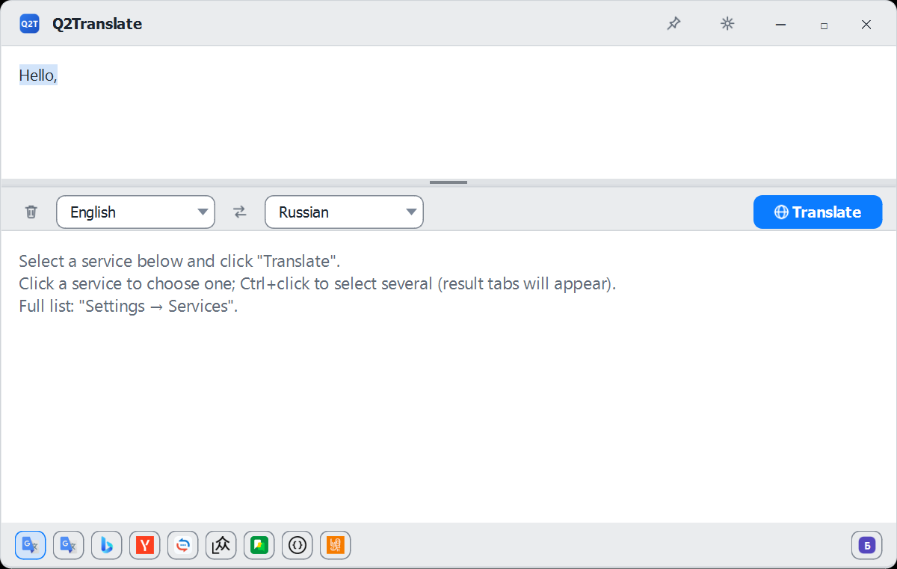
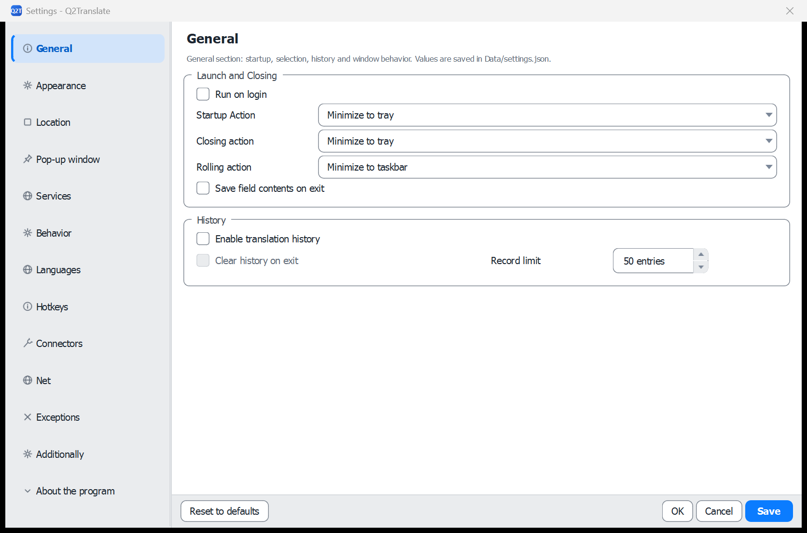
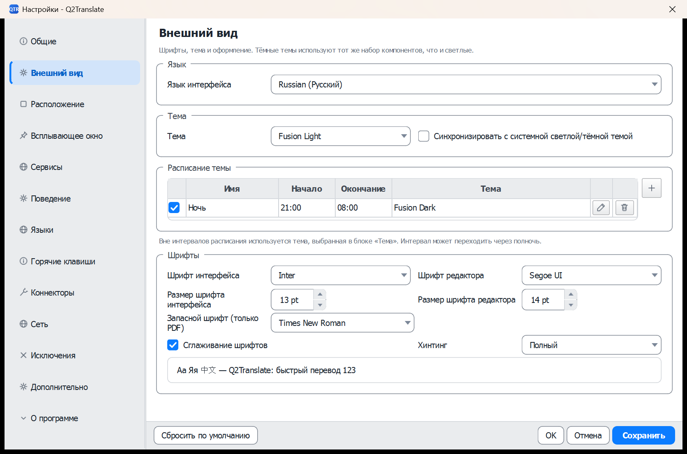
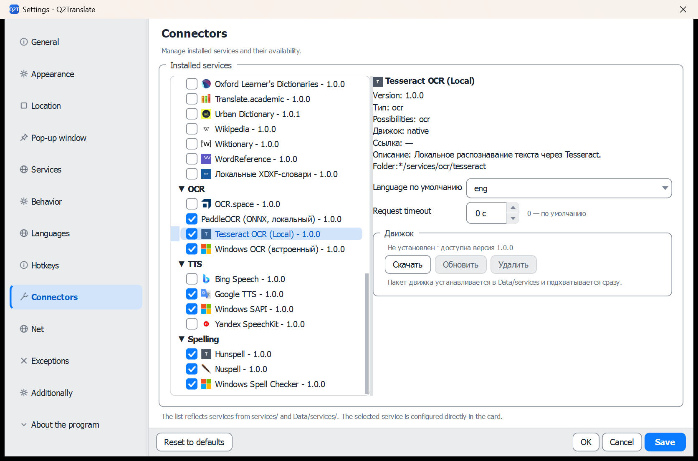
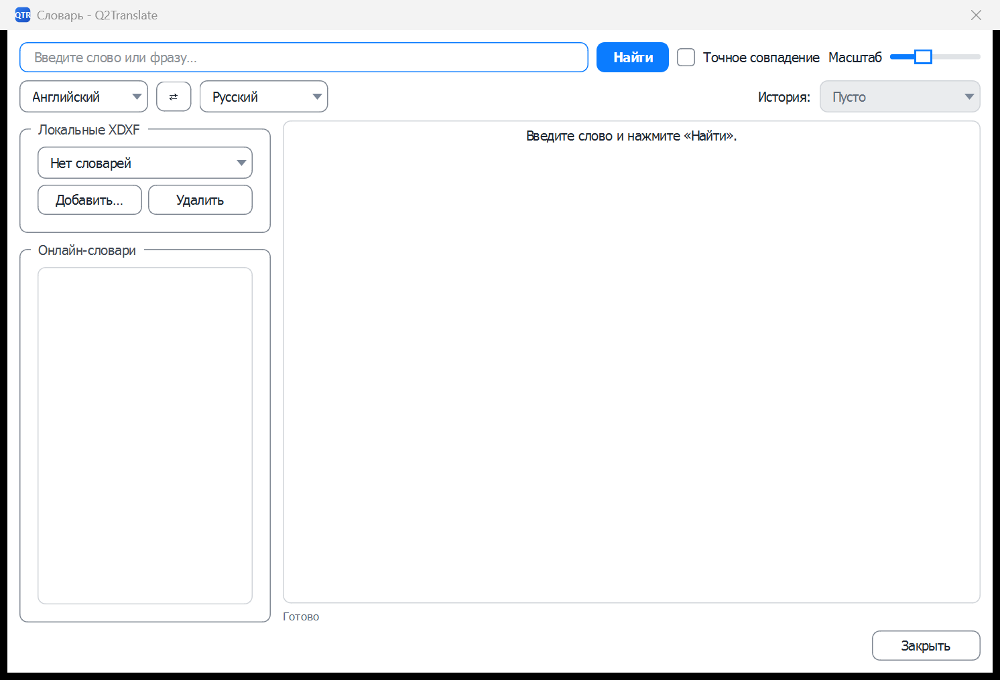
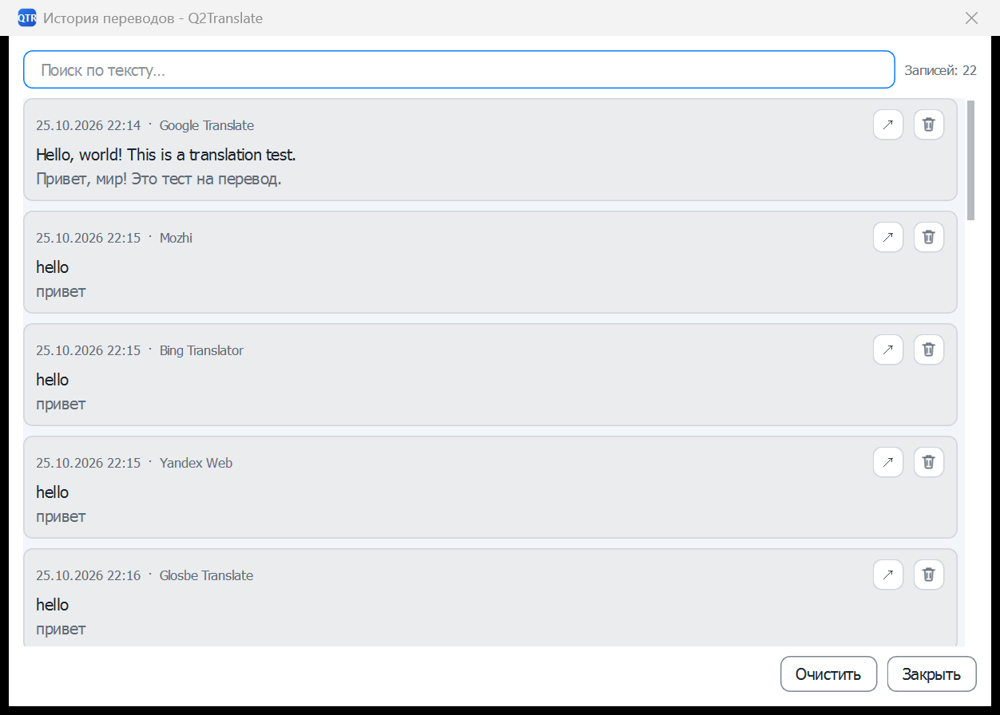
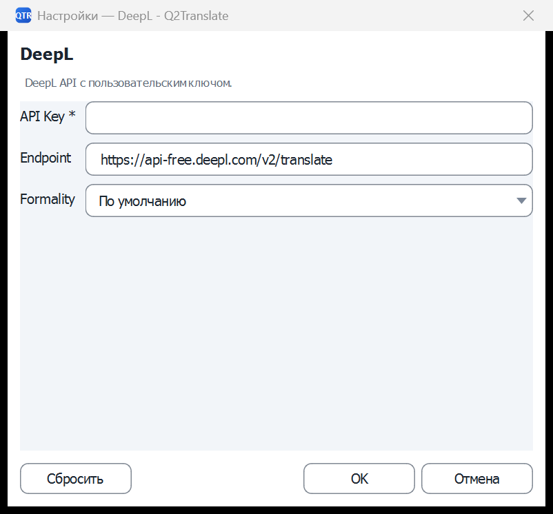
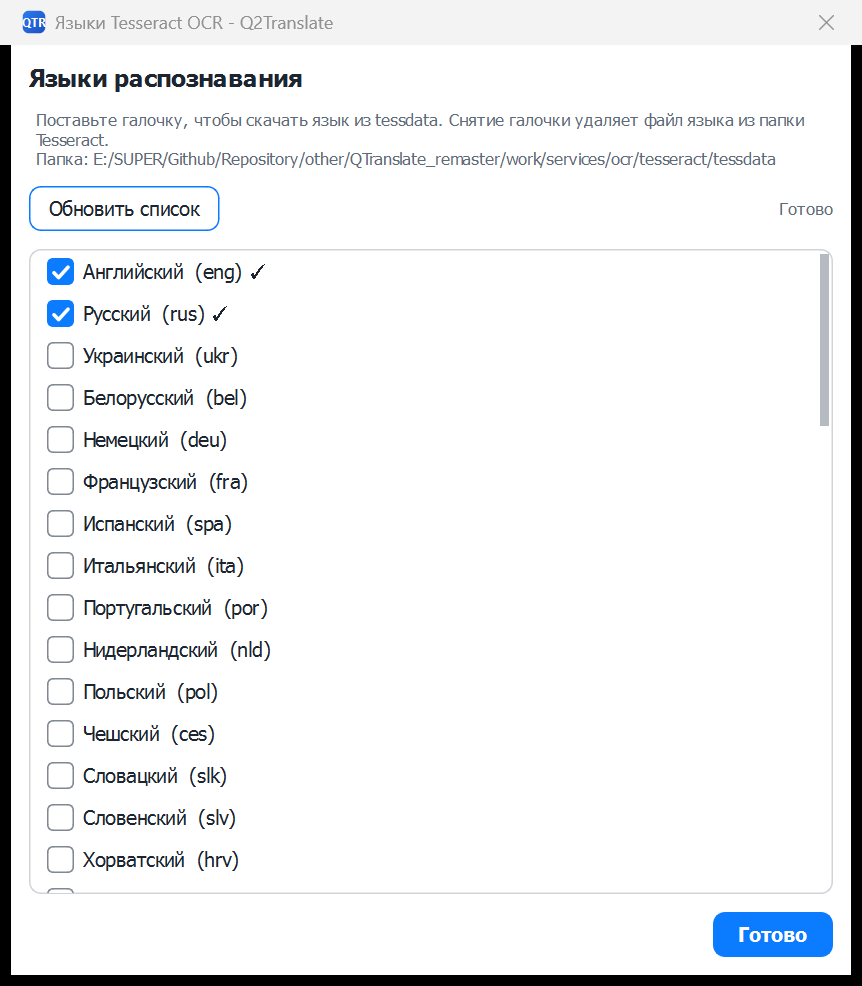
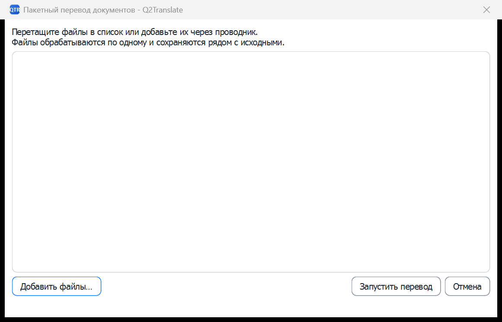

# Interface

[README](../README.md) · [Architecture](ARCHITECTURE.md) · [Connectors](CONNECTORS.md) · [Русская версия](INTERFACE.ru.md)

All screenshots below use the light **Fusion Light** theme. The interface is also available in dark themes, configured in **Settings → Appearance**.

## Main window

The main window is the primary translation workspace.

| Area | Purpose |
|---|---|
| Title bar | Drag the window, pin it above other windows, minimize, maximize, close. The same commands are available from the tray menu. |
| Source editor | Type, paste, drop a file, or use the microphone button. Spell checking follows the selected source language. |
| Language bar | Source and target language selectors, swap button, and the main **Translate** button. |
| Target editor | Translation result. The copy button copies the whole result; the result can be edited and searched. |
| Broom | Flattens the source text: joins lines with spaces, collapses repeated spaces and empty lines. OCR keeps the recognized line structure until the broom is pressed. |
| Service chips | Bottom row of enabled connectors. Click one service to translate with it; `Ctrl+click` selects several services and opens result tabs. When the chips do not fit, the row scrolls horizontally; the **Balancer** chip stays pinned to the right edge. |
| Status bar | Connection/service state and current action hints. |

The menu contains dictionary, OCR, document translation, settings, and **About**. The window remembers its geometry, splitter positions, selected languages, and service selection between runs.

A double `Ctrl` press translates the current selection in the main window. If nothing is selected, the same gesture only opens the main window, leaving the editor empty or with the last restored text.

## Settings

Settings are organised as a left navigation list. Changes are written to `Data/settings.json`; **Apply** applies without closing, **OK** applies and closes, **Cancel** discards.

| Page | Contents |
|---|---|
| **General** | Start with Windows, startup/close/minimize actions (startup defaults to **Minimize to tray**, closing to **Minimize to tray**), save editor contents, history on/off and retention. |
| **Appearance** | Interface language, theme, theme schedule, interface/editor fonts, PDF fallback font. |
| **Location** | Main window panels, service panel, history navigation, status bar, editor side buttons, density. |
| **Popups** | Window behaviour, popup style, auto-size/focus, timeout, transparency, action buttons, source/target font sizes. |
| **Services** | OCR, TTS, spelling, dictionary, summarization and paraphrasing switches with their connectors; default service order. TTS uses only the selected connector and does not silently fall back to another engine. |
| **Behavior** | Instant translation, line-break removal and spell checking stacked in one column, additional call (back translation, summarization, paraphrase), additional output type and source, always detect language, clear on drag-and-drop. |
| **Languages** | Automatic language detection mode, default and pinned languages, translation rules (English→Russian, Russian→English, Auto→Russian), speech recognition language. |
| **Hotkeys** | Global and internal hotkey profiles, OCR, quick translation, duplicate protection. |
| **Connectors** | Installed connectors, enable/disable, connector card, settings, model refresh. |
| **Network** | Proxy type (system/manual/none), timeouts, retries. |
| **Exceptions** | Applications and window classes excluded from hotkeys and mouse mode. |
| **Additionally** | Mouse mode, **Copy translation to clipboard** (on by default, applies to text and screenshot OCR), slower speech, language indicator, screen capture. The text/sound and screen-capture groups use two columns; the balancer keeps its primary connector out of the fallback list and places the return delay and general timeout on one row. |
| **About** | Current build version and a readable feature overview with enlarged typography. |

### Appearance

The theme dropdown lists all themes from `Themes/General/*.json`. Theme schedules switch between a day and a night theme at configured times; the first column of the schedule table is a checkbox that enables or disables one interval (a disabled entry stays in the list, is skipped by the scheduler and is shown dimmed). Interface and editor fonts, plus the PDF fallback font, are configured here.

### Language detection

The **Languages** page contains **Language detection**:

- **Locally, by the application** — the source language is detected by `LanguageRouter` before the request;
- **Online, by the selected service** — the selected connector receives `auto` and its `detected_lang` is used in the result and history.

The setting is stored as `General.LanguageDetection` and defaults to local detection.

### Connectors

The connector tree groups services into **Translation**, **Dictionaries**, **OCR**, **Spelling**, **TTS**, and **LLM**. The checkboxes control availability; the card on the right shows version, type, capabilities, engine, link, description, and folder. Connector-specific fields (API key, endpoint, model, cookies, tokens) are edited in the card. For Tesseract, PaddleOCR and Nuspell the card also has an **Engine** block with **Download / Update / Delete**: installed packages go to `Data/services` and are picked up immediately; Download is disabled while the engine is installed. The **Local XDXF** dictionary connector reads `*.xdxf` files from a user-selected folder and all its subdirectories. Dictionary files are not bundled and must be downloaded separately. Every subdirectory containing dictionaries appears as a selectable variant in the connector card.

### Spell checking

The **Behavior** page contains the spell-checking checkbox. The **Services** page contains the connector dropdown and the **Languages...** button.

- **Hunspell** downloads `.aff` and `.dic` files into `services/spelling/hunspell/dictionaries/<code>/` when a language is checked; unchecking removes that folder. English and Russian dictionaries are bundled; other languages are downloaded on demand.
- **Nuspell** uses the same dictionary format and bundles English and Russian dictionaries in `services/spelling/nuspell/dictionaries/`; it adds compound handling and better suggestions. It is present in the full build only; the small build defaults to Hunspell.
- **Windows Spell Checker** lists languages installed in Windows. They are managed by the system and cannot be downloaded or removed from the application.
- If no dictionary is installed for the current source language, no words are underlined.
- The dictionary follows the language automatically detected from the source text: Cyrillic text uses the Russian dictionary, Latin text uses English, regardless of whether the source selector is set to `Auto` or another language.

Right-click a word underlined in red to open the correction menu. The **Suggestions** section at the top lists replacements from the active connector; choosing one replaces the word. Standard cut/copy/paste actions follow below.

## Dictionary

The dictionary window lists every enabled dictionary connector; checked connectors get their own result tab above the page.

| Control | Purpose |
|---|---|
| Search field | Headword or phrase. `Enter` starts the search. |
| **Find** | Runs the search across selected dictionaries. |
| Exact match | Restricts results to exact headwords. Passed to dictionary connectors; the local XDXF connector enforces it. |
| Search languages | All favourite languages; the checked ones are queried, with no source→target direction. |
| History | Recently searched words; moved to the first row. |
| Dictionary list | Enabled dictionary connectors. Check the ones to search; each checked connector opens a tab above the result area. |
| Result tabs | One tab per checked dictionary, plus an empty-state tab when nothing is selected. |
| Result pane | Formatted definitions, translations, examples, and links in the active dictionary tab. |
| Bottom actions | Open the word in the main window, copy, add to favorites, delete, close. |

## History

The history window shows saved translations.

| Control | Purpose |
|---|---|
| Search | Filters by source text, translation, language, or service. |
| Favorites only | Shows entries marked as favorites. |
| Entry list | Date, source text, and service. Selecting an entry previews it. |
| Preview | Full source and translated text with language/service metadata. |
| Export | Writes the visible history to a file. |
| Clear | Removes all history after confirmation. |
| Bottom actions | Open in main window, copy translation, toggle favorite, delete entry, close. |

The retention limit is configured in **Settings → General** (50 entries by default).

## Quick translation popup

The popup translates the current selection or clipboard text without opening the main window.

| Element | Purpose |
|---|---|
| Source line | Text that was selected or copied. |
| Translation | Result from the active service; scrollable for long text. |
| Close | Hides the popup. |
| Copy | Copies the translation. |
| Speak | Reads the translation with Windows SAPI. |
| Open in main window | Opens the full editor with the same text and translates it again. |

Behavior (position, timeout, transparency, auto-focus) is configured in **Settings → Popups**. The popup can be raised by the quick-translation hotkey (assigned to `Ctrl+Q` in the User template; unassigned in the standard template).

## Plugin / connector settings

The connector settings dialog is opened from **Settings → Connectors → card** or from a connector's settings action. It shows only the fields declared by the connector manifest: endpoint, API key, model, timeout, cookie, token, or a custom field. **Reset** restores manifest defaults; **OK/Cancel** commits or discards.

## OCR languages

The OCR engine and translation connector are chosen per file group - screenshots, images, PDF, DJVU - with no "same as general" option. Defaults: screenshots, PDF and DJVU use Tesseract; images use PaddleOCR, with hybrid Paddle+Tesseract available for images. The OCR language manager downloads and removes Tesseract language data. For screenshot capture the language dropdown has **Auto**: with several configured OCR languages, Tesseract runs each candidate and keeps the highest-confidence result.

| Control | Purpose |
|---|---|
| Language list | Checked languages are installed; unchecking removes the file from `tessdata`. |
| Refresh | Re-scans the tessdata directory and installed languages. |
| Status | Shows the tessdata path and operation result. |
| Done | Closes the dialog. |

Installed language files live under `services/ocr/tesseract/tessdata`.

## OCR region capture

The OCR capture overlay appears after the OCR hotkey (`Win+Shift+Q` by default) or the OCR action. Drag a rectangle around the text; the overlay dims the rest of the screen. The captured image is sent to the selected OCR provider (Windows OCR, Tesseract, PaddleOCR, hybrid, or a vision LLM), then the recognized text can be inserted into the editor or translated immediately. The recognized line breaks are preserved so lists and table rows stay readable; use the broom button in the main window to flatten the text.

Tesseract first measures the page skew on a downscaled copy and straightens the image before recognition. Upright captures measure at zero and skip the rotation; a tilt of a few degrees is corrected because the engine otherwise merges text lines across columns, and past five degrees it stops reading the page at all. Recognition then runs the default page segmentation, which keeps column order and table rows. If a pass still returns no readable text, the provider retries once with single-block segmentation; that recovers a page but may interleave columns, so it stays a last resort.

When the captured content is a table with three or more aligned columns, the provider also rebuilds it as a Markdown table and the result window shows that instead of the plain text. Two-column prose is never treated as a table, so articles and sidebars keep their reading order.

Lines that wrap inside one paragraph are joined into a single line before translation, and hyphenated words broken at a line end are glued back together. Tables, forms, menus and code keep their line breaks, because there the breaks carry meaning.

## Images from the clipboard

Paste an image into the source field (Ctrl+V) and the app recognizes it, translates every text block as a whole and draws the result back onto the picture. The source field gets a `⟦image:<id>⟧` line with the recognized text, the translation field gets `⟦translate:<id>⟧` with the translated text. Clicking a placeholder opens the image in the system viewer.

Files live in `Data/Images/<session>/`: the source as `<id>-source.png`, the translation as `<id>-<language>.png`. With **Settings → OCR → Save translated images** off, a file is deleted as soon as its placeholder disappears from the fields; saved files stay and are removed after the retention period set next to the checkbox.

## Batch document translation

**Menu → Batch document translation** opens a window that accepts dropped files or a multi-selection from the file dialog. Each entry can be removed before the run; **Start** processes the list one file at a time and **Cancel** closes the window. Every file goes through the pipeline its extension calls for: documents and PDF/DJVU through the document job, images through the image pipeline. Results are saved next to the source as `<name>.<language>.<extension>` (DJVU with a text layer becomes TXT, a scanned DJVU becomes PDF, images become PNG).

## Document translation

**Menu → Translate document** opens a file picker with all supported document extensions. After the file is selected, a progress dialog shows the current segment and allows cancellation. When translation finishes, the translated copy is saved next to the source as `<name>.<target-language>.<extension>` and a message shows the saved path.

| Stage | What happens |
|---|---|
| Parse | The source is validated and split into translatable segments. |
| Translate | Segments are sent to the first active translation service. |
| Write | The translated copy is written atomically; the source is untouched. |
| Finish | A confirmation shows the destination path. |

If a format has no text, the service is unavailable, or a PDF is encrypted/scanned without OCR, a clear error is shown and no output file is created.

## Tray menu and global actions

The tray icon provides show/hide, quick translate, OCR, dictionary, history, settings, and exit. The tray menu respects **Settings → General → Close action** and **Minimize action**. Global hotkeys are registered through the Windows hotkey manager and can be reassigned in **Settings → Hotkeys**.
