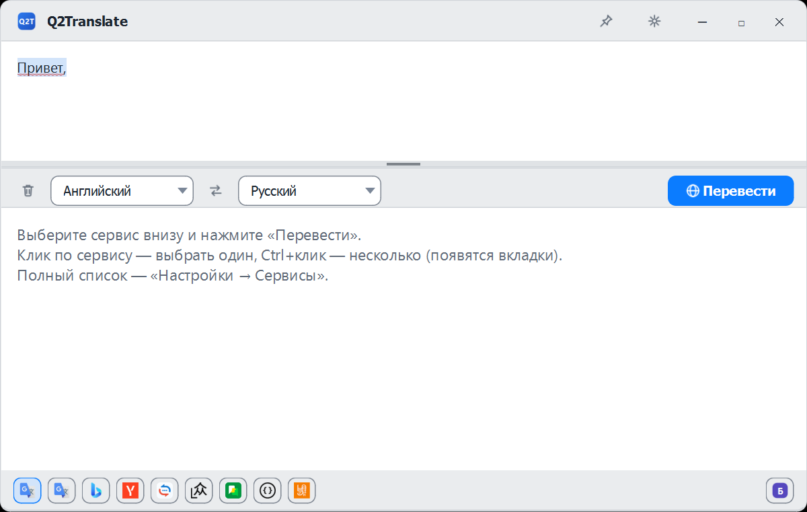
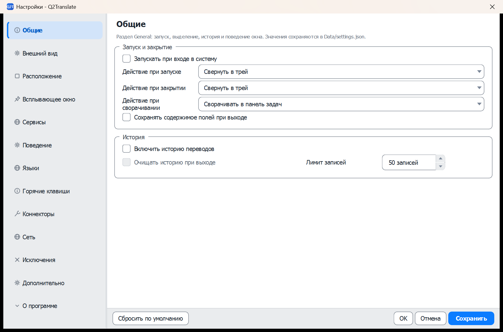
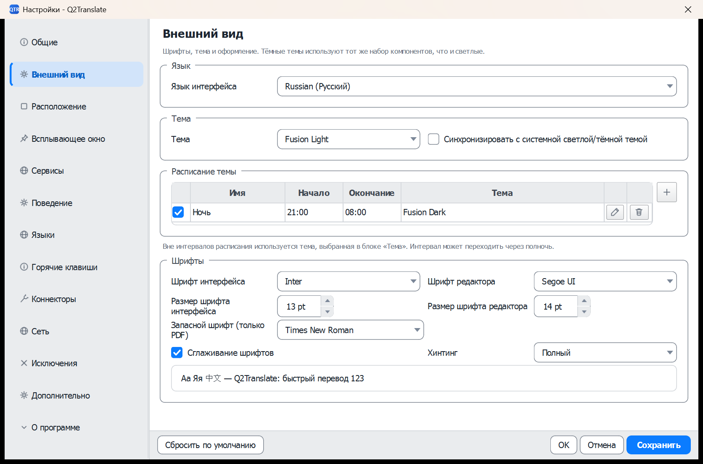
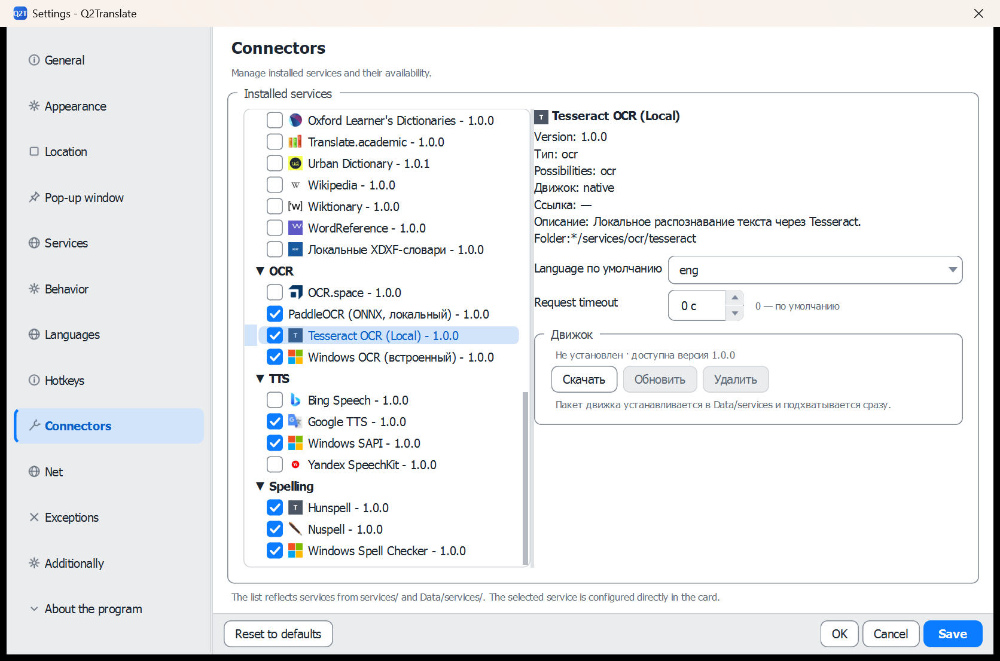
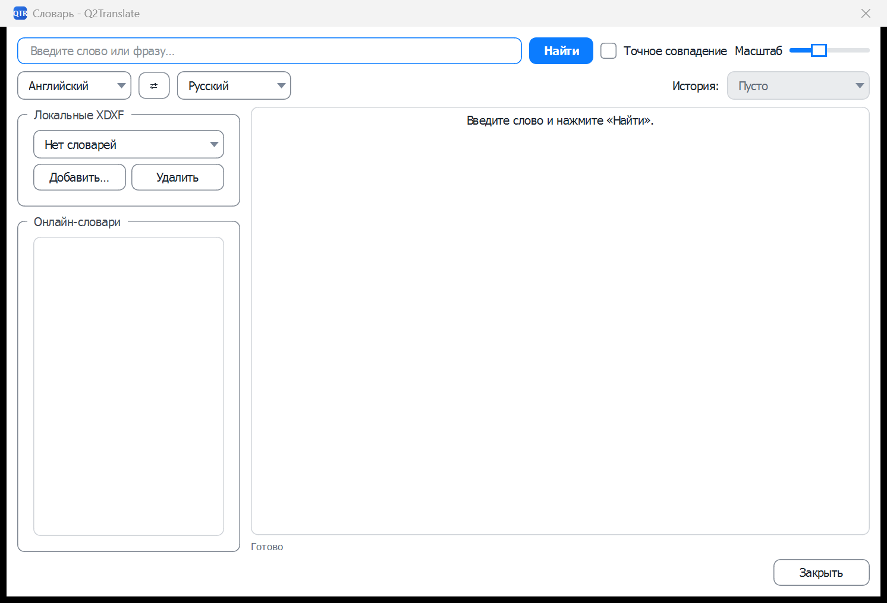
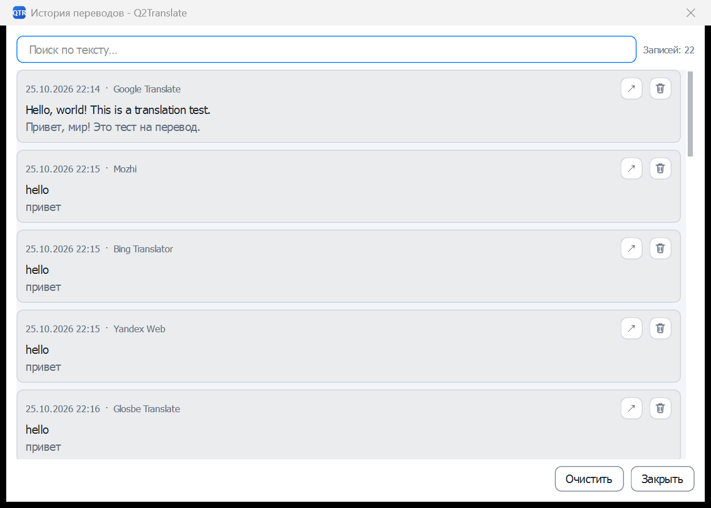
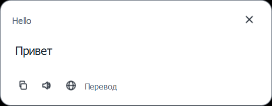
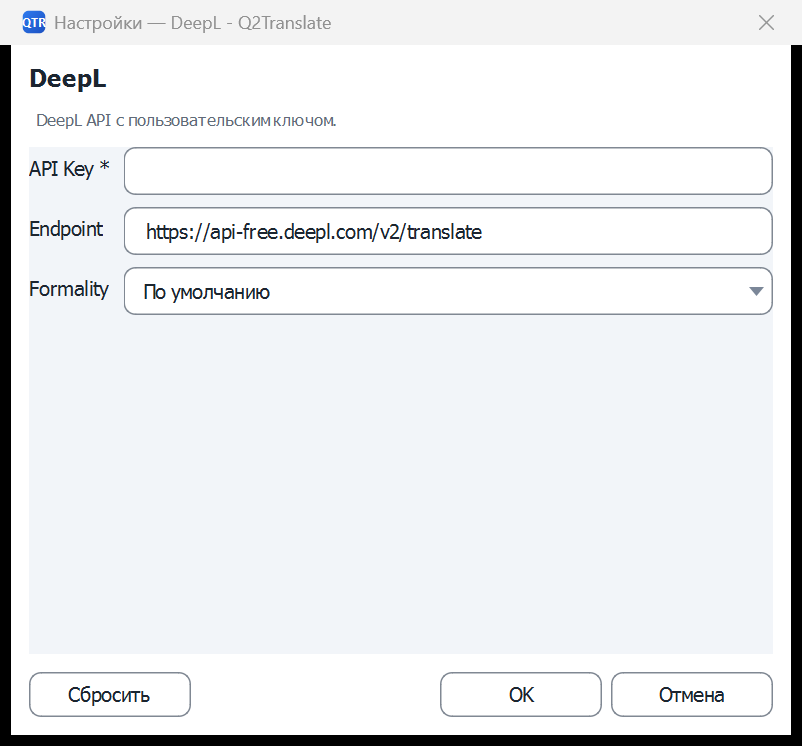
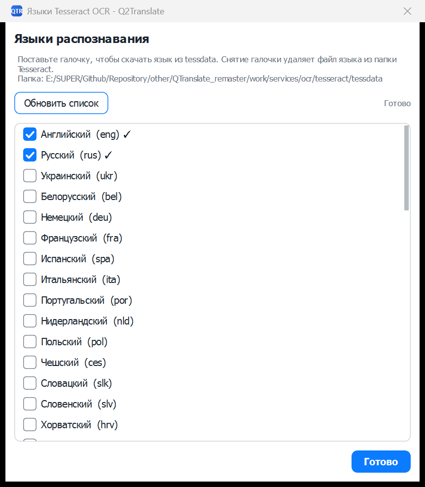
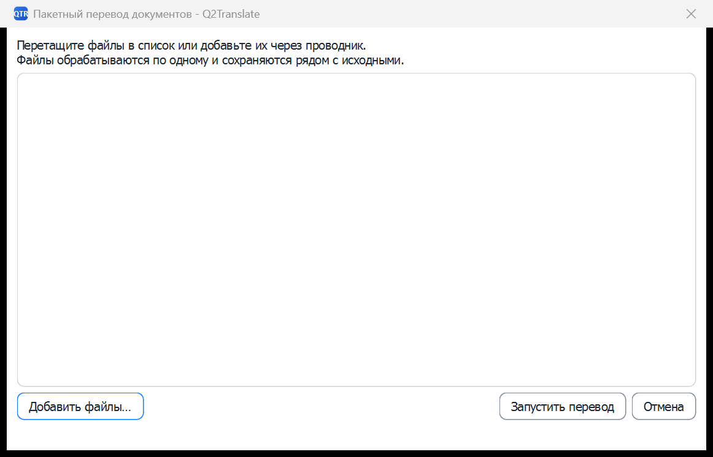

# Интерфейс

[README](../README_rus.md) · [Архитектура](ARCHITECTURE.ru.md) · [Коннекторы](CONNECTORS.ru.md) · [English](INTERFACE.md)

Все скриншоты ниже сделаны в светлой теме **Fusion Light**. Интерфейс также работает в тёмных темах, которые настраиваются в **Настройки → Внешний вид**.

## Главное окно

Главное окно — основное рабочее пространство перевода.

| Область | Назначение |
|---|---|
| Заголовок | Перетаскивание окна, закрепление поверх других, сворачивание, разворачивание, закрытие. Те же команды есть в меню трея. |
| Редактор исходника | Ввод, вставка, перетаскивание файла, кнопка микрофона. Проверка орфографии следует выбранному исходному языку. |
| Панель языков | Выбор исходного и целевого языков, кнопка swap и основная кнопка **Перевести**. |
| Редактор перевода | Результат перевода. Кнопка копирования копирует весь результат; текст можно редактировать и искать. |
| Метла | Убирает переносы строк: склеивает строки через пробел, схлопывает повторные пробелы и пустые строки. OCR сохраняет исходную структуру строк до нажатия метлы. |
| Чипы сервисов | Нижний ряд включённых коннекторов. Клик — перевод одним сервисом; `Ctrl+клик` — несколько сервисов и вкладки результатов. Если чипы не помещаются, ряд прокручивается по горизонтали, а кнопка **Балансировщик** остаётся прижатой к правому краю. |
| Строка состояния | Состояние подключения/сервиса и подсказки текущего действия. |

Меню содержит словарь, OCR, перевод документа, настройки и **«О программе»**. Окно запоминает геометрию, положение разделителей, выбранные языки и выбранные сервисы между запусками.

Двойное нажатие `Ctrl` переводит текущее выделение в главном окне. Если ничего не выделено, тот же жест просто открывает главное окно — поле остаётся пустым или с последним сохранённым текстом.

## Настройки

Настройки организованы как список разделов слева. Изменения пишутся в `Data/settings.json`; **Применить** применяет без закрытия, **OK** применяет и закрывает, **Отмена** отменяет.

| Раздел | Содержимое |
|---|---|
| **Общие** | Автозапуск, действия при старте/закрытии/сворачивании (по умолчанию старт и закрытие — «Свернуть в трей»), сохранение полей, история и лимит записей. |
| **Внешний вид** | Язык интерфейса, тема, расписание тем, шрифты интерфейса/редактора, запасной шрифт PDF. |
| **Расположение** | Панели главного окна, панель сервисов, навигация по истории, строка состояния, боковые кнопки полей, плотность. |
| **Всплывающее окно** | Поведение, стиль, автоподбор размера, фокус, таймаут, прозрачность, кнопки действий, размеры шрифтов. |
| **Сервисы** | OCR, TTS, орфография, словарь, суммаризация и реферирование с выбором коннекторов; порядок сервисов. TTS использует только выбранный коннектор и не переключается на другой движок. |
| **Поведение** | Мгновенный перевод, удаление переносов и проверка орфографии в одной колонке, дополнительный вызов (обратный перевод, суммаризация, реферирование), тип и источник дополнительного вывода, постоянное определение языка, очистка при перетаскивании. |
| **Языки** | Режим автоматического определения языка, языки по умолчанию и избранные, правила перевода (английский→русский, русский→английский, Auto→русский), язык распознавания речи. |
| **Горячие клавиши** | Глобальные и внутренние профили, OCR, быстрый перевод, защита от дубликатов. |
| **Коннекторы** | Установленные сервисы, включение/отключение, карточка, настройки, обновление списка моделей. |
| **Сеть** | Тип прокси (системный/вручную/без прокси), таймауты, повторы. |
| **Исключения** | Программы и классы окон, исключённые из горячих клавиш и mouse mode. |
| **Дополнительно** | Mouse mode, **копирование перевода в буфер обмена** (включено по умолчанию, работает и для OCR со скриншота), замедленное озвучивание, индикатор языка, захват экрана. Блоки «Текст и звук» и «Захват экрана» идут в две колонки; в балансировщике основной коннектор исключён из резервных, а «Вернуться через» и общий таймаут стоят в одной строке. |
| **О программе** | Текущая версия сборки и более крупный, читаемый обзор возможностей. |

### Внешний вид

Список тем формируется из `Themes/General/*.json`. Расписание переключает дневную и ночную темы по времени: в таблице интервалов первая колонка с галочкой включает и выключает конкретную запись (выключенная остаётся в списке, но планировщик её пропускает и строка показывается приглушённой). Здесь же настраиваются шрифты интерфейса/редактора и запасной шрифт для PDF.

### Определение языка

На странице **Языки** есть параметр **Определение языка**:

- **Локально, приложением** — исходный язык определяется `LanguageRouter` до запроса;
- **Онлайн, используемым сервисом** — выбранный коннектор получает `auto`, а его `detected_lang` используется в результате и истории.

Настройка хранится в `General.LanguageDetection`; по умолчанию выбрано локальное определение.

### Коннекторы

Дерево коннекторов группирует сервисы по разделам **Перевод**, **Словари**, **OCR**, **Орфография**, **TTS** и **LLM**. Чекбоксы управляют доступностью; карточка справа показывает версию, тип, возможности, движок, ссылку, описание и папку. Поля коннектора (API-ключ, endpoint, модель, cookies, токены) редактируются прямо в карточке. Для Tesseract, PaddleOCR и Nuspell в карточке есть блок **Движок** с кнопками **Скачать / Обновить / Удалить**: пакет ставится в `Data/services` и подхватывается сразу, а после установки кнопка «Скачать» неактивна. Словарный коннектор **Local XDXF** читает файлы `*.xdxf` из выбранной папки и всех её подкаталогов. Файлы словарей в поставку не входят и скачиваются отдельно. Каждый подкаталог со словарями становится отдельным вариантом выбора в карточке коннектора.

### Проверка орфографии

Галочка включения проверки орфографии находится на странице **Поведение**, а список коннекторов и кнопка **Языки...** — на странице **Сервисы**.

- **Hunspell** скачивает файлы `.aff` и `.dic` в `services/spelling/hunspell/dictionaries/<код>/` при установке галочки; снятие галочки удаляет папку языка. Английский и русский словари уже включены; остальные языки скачиваются по запросу.
- **Nuspell** использует тот же формат словарей; английский и русский словари лежат в `services/spelling/nuspell/dictionaries/`. Добавляет обработку составных слов и качественные подсказки. Есть только в полной сборке; в урезанной по умолчанию Hunspell.
- **Windows Spell Checker** показывает языки, установленные в Windows. Они управляются системой и не скачиваются и не удаляются приложением.
- Если для исходного языка словарь не установлен, слова не подчёркиваются.
- Словарь выбирается по автоматически определённому языку исходного текста: для кириллицы — русский, для латиницы — английский, независимо от того, выбран в главном окне `Auto` или другой язык.

Нажмите правой кнопкой мыши на слово с красным подчёркиванием — вверху меню появится раздел **«Варианты исправления»** с заменами от активного коннектора. Выбор замены заменяет слово; ниже идут стандартные действия вырезать/копировать/вставить.

## Словарь

Окно словаря ищет по локальным и онлайн-словарям.

| Элемент | Назначение |
|---|---|
| Поле поиска | Слово или фраза. `Enter` запускает поиск. |
| **Найти** | Поиск по выбранным словарям. |
| Точное совпадение | Только точные заголовки. |
| Языки | Исходный и целевой языки для онлайн-словарей. |
| Масштаб | Масштаб области результата. |
| История | Недавние запросы. |
| Локальные XDXF | Добавление и удаление отдельных `.xdxf`; коннектор Local XDXF сканирует выбранную папку и её подкаталоги. |
| Онлайн-словари | Включение словарных коннекторов для окна. |
| Результат | Определения, переводы, примеры и ссылки. |
| Нижние кнопки | Открыть в главном окне, копировать, в избранное, удалить, закрыть. |

## История

Окно истории показывает сохранённые переводы.

| Элемент | Назначение |
|---|---|
| Поиск | Фильтр по исходнику, переводу, языку или сервису. |
| Только избранное | Показывает записи с отметкой. |
| Список | Дата, исходный текст и сервис. Выбор показывает предпросмотр. |
| Предпросмотр | Полный исходник и перевод с языками и сервисом. |
| Экспорт | Сохраняет видимую историю в файл. |
| Очистить | Удаляет всю историю после подтверждения. |
| Нижние кнопки | Открыть в главном окне, копировать перевод, избранное, удалить запись, закрыть. |

Лимит записей — **Настройки → Общие** (по умолчанию 50).

## Всплывающее окно перевода

Окно переводит текущее выделение или текст буфера обмена без открытия главного окна.

| Элемент | Назначение |
|---|---|
| Строка исходника | Выделенный или скопированный текст. |
| Перевод | Результат активного сервиса; прокручивается при длинном тексте. |
| Закрыть | Скрывает окно. |
| Копировать | Копирует перевод. |
| Озвучить | Читает перевод через Windows SAPI. |
| Открыть в главном окне | Открывает полный редактор с этим текстом и переводит заново. |

Позиция, тайм-аут, прозрачность и автофокус настраиваются в **Настройки → Всплывающие окна**. Окно вызывается горячей клавишей быстрого перевода (`Ctrl+Q` по умолчанию).

## Настройки коннектора

Диалог открывается из **Настройки → Коннекторы → карточка** или из действия настроек коннектора. Он показывает только поля из манифеста: endpoint, API-ключ, модель, тайм-аут, cookie, токен или произвольное поле. **Сбросить** возвращает значения манифеста; **OK/Отмена** сохраняет или отменяет.

## Языки OCR

Движок OCR выбирается по типу файла — скриншоты, изображения, PDF, DJVU — на той же странице настроек; пустое значение означает общий OCR-коннектор. Менеджер языков скачивает и удаляет данные Tesseract.

| Элемент | Назначение |
|---|---|
| Список языков | Отмеченные языки установлены; снятие галочки удаляет файл из `tessdata`. |
| Обновить список | Повторно сканирует tessdata и установленные языки. |
| Статус | Путь tessdata и результат операции. |
| Готово | Закрывает диалог. |

Файлы языков лежат в `services/ocr/tesseract/tessdata`.

## Захват области OCR

Оверлей OCR появляется по горячей клавише (`Win+Shift+Q` по умолчанию) или через действие OCR. Выделите прямоугольник вокруг текста; остальной экран затемняется. Изображение отправляется выбранному OCR-провайдеру (Windows OCR или Tesseract), затем распознанный текст можно вставить в редактор или сразу перевести.

Tesseract сначала измеряет перекос страницы по уменьшенной копии и выравнивает изображение до распознавания. Ровные снимки дают ноль и поворот пропускают; наклон в несколько градусов исправляется, потому что иначе движок склеивает строки соседних колонок, а после пяти градусов вообще перестаёт читать страницу. Затем работает штатная сегментация страницы, которая сохраняет порядок колонок и строки таблиц. Если проход всё равно не дал читаемого текста, провайдер один раз повторяет его с сегментацией единым блоком; это вытаскивает страницу, но может перемешать колонки, поэтому остаётся крайней мерой.

Если в кадре таблица с тремя и более выровненными колонками, провайдер дополнительно собирает её как Markdown-таблицу, и окно результата показывает её вместо обычного текста. Текст в две колонки таблицей не считается, поэтому статьи и боковые врезки сохраняют порядок чтения.

Строки, перенесённые внутри одного абзаца, перед переводом склеиваются в одну, а слова с переносом на конце строки собираются обратно. Таблицы, формы, меню и код переносы сохраняют — там они несут смысл.

## Изображения из буфера

Вставьте изображение в поле исходного текста (Ctrl+V) — приложение распознаёт его, переводит каждый блок целиком и рисует результат обратно на картинку. В исходном поле появляется строка `⟦image:<id>⟧` с распознанным текстом, в поле перевода — `⟦translate:<id>⟧` с переводом. Клик по плейсхолдеру открывает изображение системным просмотрщиком.

Файлы лежат в `Data/Images/<session>/`: исходное — `<id>-source.png`, переведённое — `<id>-<язык>.png`. Если галочка **Настройки → OCR → Сохранять переведённые изображения** снята, файл удаляется сразу, как только плейсхолдер исчезает из полей; сохранённые остаются и удаляются по сроку хранения, указанному рядом с галочкой.

## Пакетный перевод документов

**Меню → Пакетный перевод документов** открывает окно, куда можно перетащить файлы или выбрать их через проводник с множественным выбором. Записи можно удалять до запуска; **Запустить** обрабатывает список по одному файлу, **Отмена** закрывает окно. Каждый файл идёт в свой пайплайн по расширению: документы и PDF/DJVU — через задание перевода документа, изображения — через конвейер изображений. Результат сохраняется рядом с исходным как `<имя>.<язык>.<расширение>` (DJVU с текстовым слоем становится TXT, скан DJVU — PDF, изображения — PNG).

## Перевод документа

**Меню → Перевести документ** открывает выбор файла со всеми поддерживаемыми расширениями. После выбора показывается прогресс с текущим сегментом и возможностью отмены. По завершении перевод сохраняется рядом с исходником как `<имя>.<целевой-язык>.<расширение>`, а сообщение показывает путь.

| Этап | Что происходит |
|---|---|
| Разбор | Исходник проверяется и разбивается на переводимые сегменты. |
| Перевод | Сегменты отправляются первому активному сервису. |
| Запись | Перевод пишется атомарно; исходник не меняется. |
| Завершение | Подтверждение показывает путь к файлу. |

Если в формате нет текста, сервис недоступен или PDF зашифрован/не имеет текстового слоя, показывается понятная ошибка, а выходной файл не создаётся.

## Трей и глобальные действия

Иконка в трее даёт показать/скрыть окно, быстрый перевод, OCR, словарь, историю, настройки и выход. Меню трея учитывает **Настройки → Общие → Действие при закрытии** и **Действие при сворачивании**. Глобальные горячие клавиши регистрируются через Windows hotkey manager и меняются в **Настройки → Горячие клавиши**.
